# z-event architecture

z-event is a Rust library for reliable, push-based communication between services without a message broker.

A producing service writes its events into its own database, in the same transaction as the business change that caused them. It then serves those events as an ordered feed, and consuming services subscribe to the feed and receive new events as soon as they are committed. Each consumer stores its position in the feed in the same transaction as the effect of the event, so an event is never lost and never applied twice.

This document explains why the library exists, how it is built, and how each part behaves when things go wrong. It is meant to be read from top to bottom the first time. The usage guide is in [docs/guide.md](docs/guide.md), operations are in [docs/operating.md](docs/operating.md), and adapter authors should read [docs/writing-an-adapter.md](docs/writing-an-adapter.md).

The examples use one small domain throughout. An `orders` service confirms orders, and three services react to that. `billing` creates an invoice, `notifications` sends an email, and `search` updates its index.

## 1. The problem

A user action often changes data in one service and must cause effects in other services. When an order is confirmed in `orders`, an invoice must appear in `billing`, an email must go out through `notifications`, and the order must become findable in `search`.

The obvious design is to commit the change and then call the other services. It breaks in several ways, and the diagram below shows them.

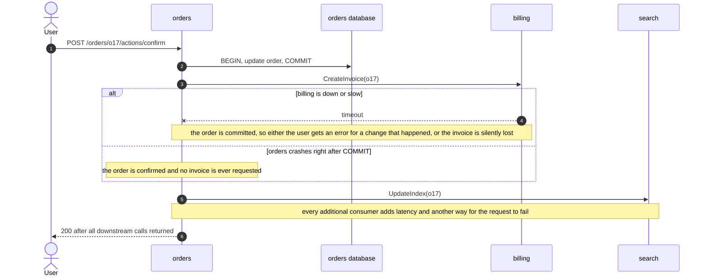

Calling the other services before the commit does not help. If the transaction then rolls back, billing has an invoice for an order that was never confirmed.

This is the dual-write problem. Two systems, the service's database and a remote call, cannot be updated atomically. Every reliable solution has the same core idea, which is to write the event into the service's own database in the same transaction as the change and to deliver it afterwards. The design question is only what delivers it afterwards.

## 2. Requirements

These are the properties the delivery mechanism must have. The rest of the document refers to them by number.

| Number | Requirement |
|---|---|
| R1 | No event is lost, even when a consumer or the network is down |
| R2 | An event exists only if the business change committed, so a rollback leaves no trace |
| R3 | The user's request neither waits for nor fails because of downstream services |
| R4 | Consumers receive events as they happen, without polling |
| R5 | One event can have many consumers, and new consumers are added without changing the producer |
| R6 | Events about the same record arrive in order, so version 3 never overwrites version 4 |
| R7 | A consumer can replay history to rebuild what it derived from the events |
| R8 | No extra infrastructure beyond the databases the services already run |

## 3. Options considered

There are four common ways to deliver an outbox, and the table compares them against the requirements.

| Option | How events reach consumers | Where it falls short |
|---|---|---|
| A. Synchronous calls | They do not, the producer calls each consumer inside the request | Fails R1, R3 and R5, and is the problem from section 1 |
| B. Message broker such as Kafka, NATS JetStream or RabbitMQ | A relay copies the outbox into the broker and consumers subscribe to the broker | Meets R1 to R7 but fails R8, since a clustered stateful system has to be installed, secured, backed up and monitored |
| C. Producer pushes to consumers | The producer calls every consumer from the outbox and retries on failure | The producer has to know its consumers and keep retry state for each of them |
| D. Consumers subscribe to the producer's feed | The producer exposes its outbox as an ordered stream and each consumer subscribes from its own position | Meets all eight requirements |

z-event implements option D. It is option C turned around. The consumer owns its position in the feed and the producer only owns its log, so the producer keeps no state per consumer apart from retention bookkeeping. Exactly-once effects become almost free, because the consumer commits its position together with the effect.

A broker is still the right choice at very high volume or when systems outside your control must consume the events. Section 19 describes those limits and the migration path.

## 4. Architecture, core, ports and adapters

z-event separates what must be true about event delivery from the technology used to achieve it. The core crate contains the protocol, the producer and the consumer logic, and it talks to storage and network only through traits called ports. Adapters implement those ports for a concrete database or transport.

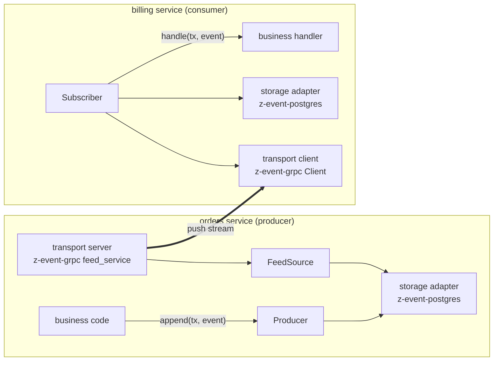

The repository contains these crates.

| Crate | Folder | Role |
|---|---|---|
| `z-event` | `core/` | Envelope, protocol, ports, `Producer`, `FeedSource`, `Subscriber`, the in-process transport, metrics and tracing |
| `z-event-memory` | `adapters/memory/` | In-memory storage, the reference implementation used by tests and examples |
| `z-event-postgres` | `adapters/postgres/` | PostgreSQL storage on sqlx 0.8 |
| `z-event-grpc` | `adapters/grpc/` | gRPC transport on tonic 0.14 |
| `z-event-cli` | `cli/` | Operations commands for inspecting and repairing feeds and consumers |
| `z-event-testkit` | `testkit/` | Conformance suites that every storage and transport adapter must pass |

Dependencies point inward. Adapters depend on the core, and the core never depends on an adapter, a database driver or a gRPC library. A CI script checks this on every pull request.

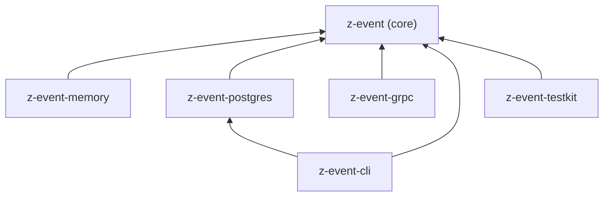

The ports are traits in the core.

| Port | Implemented by | Purpose |
|---|---|---|
| `Store` and `OutboxStore` | a storage adapter, on the producer side | append, sequence, read the feed, notify, track consumers, purge |
| `Store` and `CursorStore` | a storage adapter, on the consumer side | keep cursors and parked events |
| `Transport` | a transport adapter, on the consumer side | open a subscription to a producer |
| `Handler` | the host application | apply one event inside the consumer's transaction |
| `Acl` and `Snapshotter` | the host application | decide who may read what, and describe current state for new consumers |

A service can be a producer, a consumer or both. In practice it uses one storage adapter for both roles, so a consumer that also produces events can write its effect, its cursor and its own outgoing events in one transaction.

The in-process transport lives in the core because it needs nothing but tokio channels. Several services can run in one process with the same outbox, sequencer and subscriber code, which is how most tests run and how a small installation can start.

## 5. The envelope

Every event travels in the same envelope.

| Field | Type | Meaning |
|---|---|---|
| `seq` | u64 | Position in the producer's feed, assigned by the sequencer, gapless and in commit order |
| `id` | ULID | Globally unique id, used as the idempotency key for external side effects |
| `type` | string | The event type, for example `OrderConfirmed`, used by filters and access control |
| `version` | u32 | Version of the payload schema, so consumers can accept N and N-1 during a rollout |
| `aggregate` | string | The record the event is about, for example `orders/o17`, the unit of ordering and parking |
| `aggregate_version` | u64 | Version of that record after the change, so handlers can ignore stale or repeated events |
| `correlation_id` | optional string | Request id of the user action, for tracing across services |
| `occurred_at` | timestamp | When the business change happened |
| `headers` | map of strings | Host metadata such as the tenant or the acting user, never interpreted by z-event |
| `payload` | bytes | The event body defined by the host, usually JSON, never interpreted by z-event |

In Rust the type field is called `Event::event_type` and is serialised as `type`. An empty correlation id or epoch on the wire means that there is none.

z-event has no schema registry. Hosts define their event types, typically in a shared crate, and serialise them into the payload.

## 6. Write path, the outbox and the commit-order gap

The producer appends events through the storage adapter's transaction, the same transaction the host uses for its business change. If the transaction commits, the change and the event exist together. If it rolls back, neither exists. That gives R1 and R2 directly from the database's atomicity.

```rust
let mut tx = store.begin().await?;
sqlx::query("UPDATE orders.orders SET status = 'confirmed' WHERE id = $1")
    .bind("o17")
    .execute(&mut *tx)
    .await?;
producer
    .append(&mut tx, NewEvent::json("OrderConfirmed", "orders/o17", 3, &confirmed)?.correlation(request_id))
    .await?;
store.commit(tx).await?;
```

There is a subtle trap in reading an outbox. Databases assign row ids when a row is inserted, but transactions become visible when they commit, and the two orders differ. A reader that streams every row after the last id it saw can skip an event for good.

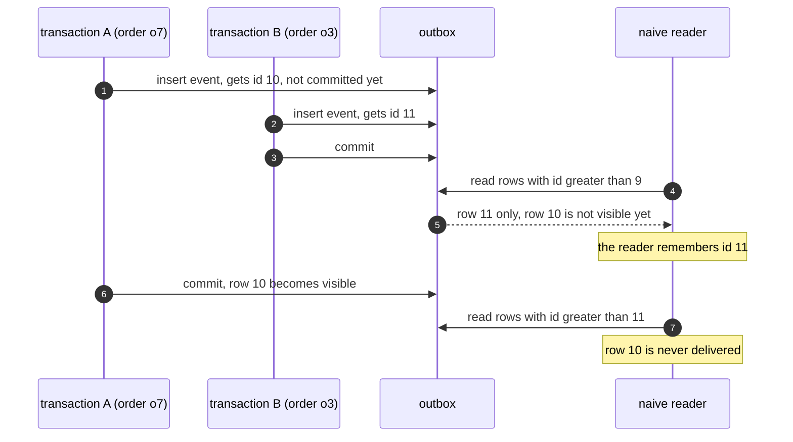

z-event closes this gap with a sequencer. Writers insert events without a position. One sequencer per producer, the leader, stamps committed events with the next positions. Uncommitted events are invisible to it, so an event receives its position only after it committed, and the feed is gapless and append-only in delivery order.

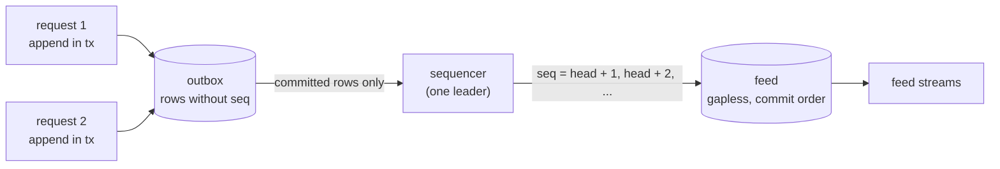

Every storage adapter must satisfy the sequencing contract, and the conformance suite checks it with concurrent transactions that commit in random order.

1. A position is assigned only to committed events.
2. Positions increase strictly and without gaps within one epoch.
3. Once an event has a position it never changes, and nothing is later inserted below the head.
4. Two events for the same aggregate receive positions in their commit order.

The sequencer wakes up when a commit notification arrives, so the delay between commit and feed is normally a few milliseconds. A safety timer of one second covers a lost notification. That timer is internal housekeeping of the producer, and consumers never poll.

Leadership is a lease provided by the storage adapter. If the leader dies, its lease is released or expires, another replica acquires it and continues from the head.

## 7. Delivery path, subscribe once, events are pushed

A consumer opens one long-lived stream per producer. The protocol is defined in the core, and transports only carry it.

| Direction | Message | Meaning |
|---|---|---|
| consumer to producer | `Start { consumer, from_seq, epoch, types }` | I have applied everything up to `from_seq` in this epoch, send me these types |
| consumer to producer | `Ack { applied_seq }` | I have durably applied everything up to here, sent every few seconds |
| producer to consumer | `Event` | One event, in position order |
| producer to consumer | `Checkpoint { seq, head, epoch }` | Every matching event up to `seq` was sent before this message |

The epoch in `Start` is empty on the first subscribe. An empty type list means every type the access control list lets this consumer read. Acks feed metrics and retention, and delivery never waits for them.

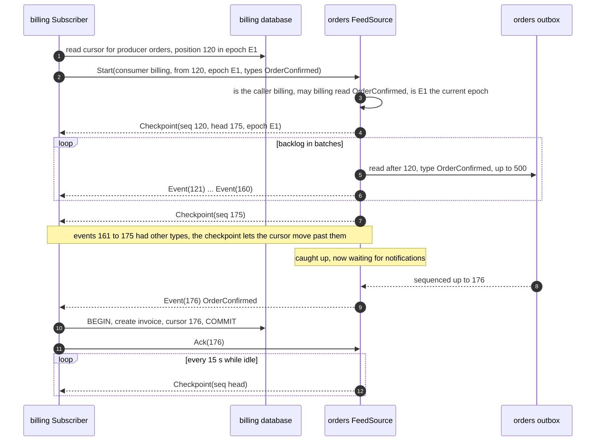

A stream always opens with a checkpoint at the consumer's position. It tells a new consumer which epoch the feed is in.

The stream is pull-based. Nothing is read from storage until the transport asks for the next message, so the transport's flow control is the backpressure, and dropping the stream cancels it. A slow consumer never affects the producer's request path.

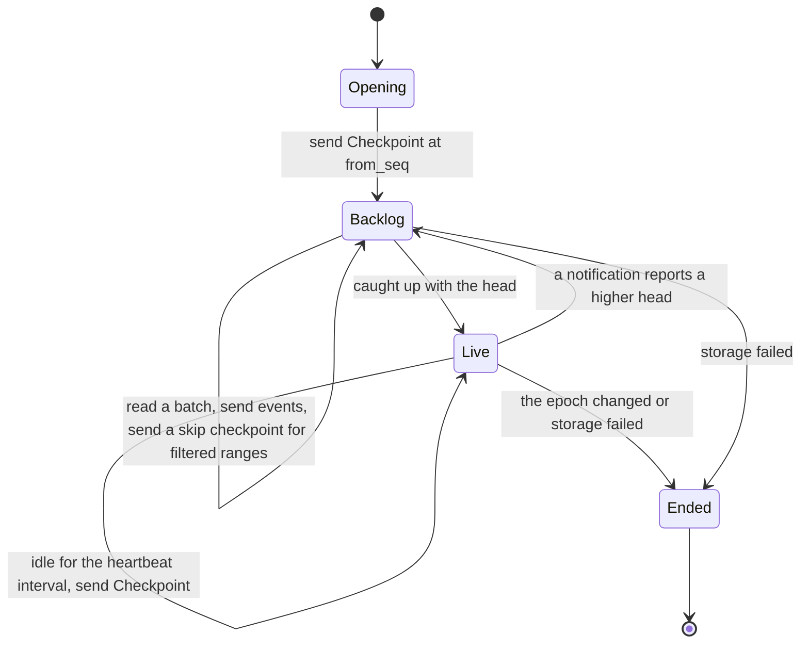

The stream subscribes to notifications before it reads the head, so an event sequenced between the two is never missed.

## 8. Consumer processing, effectively exactly-once

The stream is at-least-once. After a reconnect, the producer sends everything after the stored cursor again, so the consumer must tolerate repeats. It does so by committing the effect and the cursor in one transaction and by skipping any event at or below the cursor.

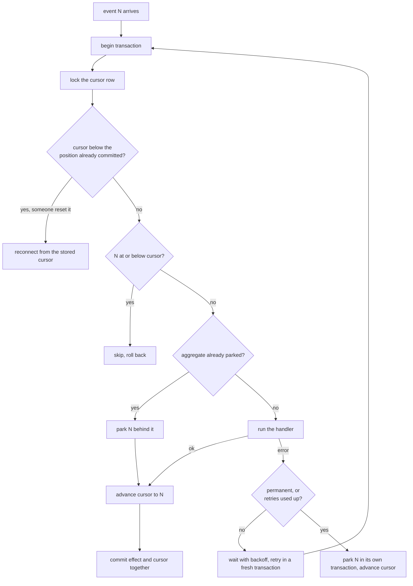

The cursor lock is exclusive per pair of consumer and producer, so two replicas of the same consumer cannot apply the same event, and the duplicate check makes repeats harmless.

A handler error or a failed commit counts as one attempt. Every retry runs in a fresh transaction, because a failed SQL transaction cannot continue.

The guarantee depends on the kind of effect.

| Kind of consumer | Example | Guarantee | How |
|---|---|---|---|
| Database effect | billing creates an invoice, search updates its index table | Exactly-once effect | the effect and the cursor commit together |
| External side effect | notifications sends an email, a connector calls a third-party API | At-least-once with idempotency | the handler writes a job row in the same transaction as the cursor, and a worker performs the job with the event id as its idempotency key |

The same rule holds on both sides of a feed. Nothing leaves a service except from a committed row.

Events that arrive together can be applied in batches with `SubscriberBuilder::batch_size`. A batch is one transaction, and only events already buffered in the stream are batched, so batching never adds latency. If anything in the batch fails, the transaction rolls back and the events are applied one at a time with the normal retry and parking rules.

## 9. Failure scenarios

| Scenario | What happens | Result |
|---|---|---|
| Consumer down for minutes or days | The producer keeps appending. When the consumer returns it subscribes from its cursor, receives the backlog at full speed and then switches to live delivery | Nothing lost, within the retention period |
| Consumer crashes while applying an event | Its transaction rolls back, so neither the effect nor the cursor moved. The event is sent again after the reconnect | Applied exactly once |
| Network drops mid-stream | The subscriber reconnects with exponential backoff and jitter and states its cursor | Repeats are skipped by the duplicate check |
| Producer down | No new events can occur there anyway, and consumers keep retrying the connection | Nothing to lose |
| Sequencer leader dies | Another replica acquires the lease and continues from the head | A short delay and no gaps |
| Slow consumer | Transport backpressure holds the stream back and its lag grows until the lag alert fires | The producer is unaffected |
| Poison event that always fails | It is retried and then parked, and other aggregates keep flowing, as section 10 explains | Visible in metrics, replayable after a fix |
| Producer restored from a backup | Detected through the epoch, and consumers stop with an alert instead of diverging, as section 11 explains | Rebuild from a snapshot |

The failover of the sequencer looks like this with PostgreSQL, where the lease is an advisory lock held by a dedicated connection.

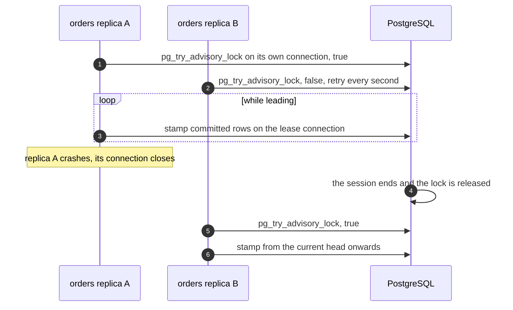

## 10. Poison events and parking

A handler returns either a transient error, such as a timeout or a lock conflict, or a permanent error, such as a bug or an unexpected payload. Transient errors are retried in place with backoff. A permanent error, or a transient one that exceeds the retry budget, must not block the whole stream, and it must also not let later events for the same aggregate overtake it. The subscriber therefore parks the aggregate, not the stream.

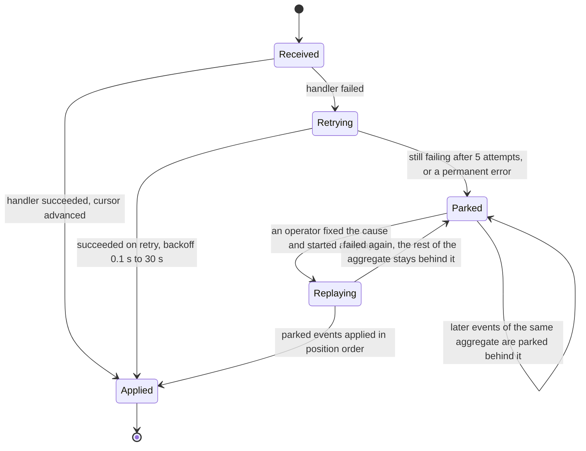

The cursor still advances past a parked event, so other aggregates keep flowing. Parked events live in the consumer's storage, and the `feed_dead_letters` metric counts them.

Here is a concrete run. Events 1 to 5 belong to aggregates A, B, A, B and A, and the handler fails permanently for aggregate A.

| Position | Aggregate | Outcome |
|---|---|---|
| 1 | A | parked after one attempt, because the error is permanent |
| 2 | B | applied |
| 3 | A | parked behind event 1 without running the handler |
| 4 | B | applied |
| 5 | A | parked behind event 1 |

After the bug is fixed, `Subscriber::replay_parked` runs the handler for events 1, 3 and 5 in that order, each in its own transaction, and marks them resolved. If event 1 fails again, events 3 and 5 stay parked behind it. Replay runs the service's own handlers, so it is exposed through the service, either as an admin endpoint or as the `parked replay` command mounted in the service's binary.

## 11. Retention, replay, snapshots and epochs

### Retention

The producer deletes an event when it was sequenced longer ago than the retention period, 90 days by default, and every registered consumer has acknowledged it. Consumers register automatically with their first `Start`, so a consumer that stops acknowledging holds back deletion and the lag alert catches it before history is lost. A decommissioned consumer is removed explicitly with `z-event-cli consumers remove`.

Retention deletes a contiguous prefix of the feed and never the head event, and the store remembers the boundary as `purged_through`. Only the replica that currently leads the sequencer purges.

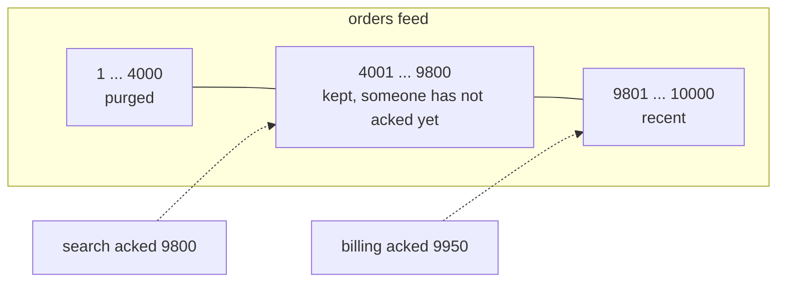

A consumer whose cursor is below `purged_through` cannot continue from the feed, because events it never saw are gone. The producer refuses it with `BeyondRetention` instead of letting it skip events silently.

### Replay

A consumer resets its cursor to an earlier position and subscribes again. Handlers that check `aggregate_version` make a replay over already applied data safe. Read models and search indexes are rebuilt this way.

### Snapshots and bootstrap

A new consumer, or one that fell below the retention window, does not need the whole history. It can start from the producer's current state instead.

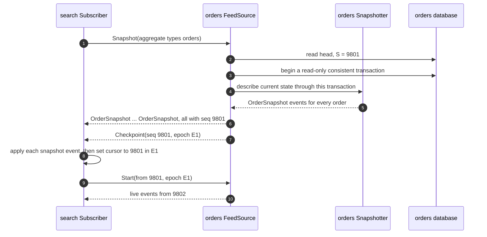

The head is read before the state, so a change committed in between appears in the snapshot and is delivered again after it. Handlers that honour `aggregate_version` treat that repeat as a no-op.

A subscriber bootstraps by itself when it is built with `bootstrap_from_snapshot(aggregate_types)`. That happens when its cursor is new and when the producer refuses its cursor as below the retention window. An operator can also run `Subscriber::bootstrap` explicitly after a rebuild. Snapshot events are applied in their own transactions and then the cursor moves to the snapshot position with the feed's epoch, so an interrupted bootstrap can simply run again. Snapshot events all share one position and cannot be parked, so a snapshot event that keeps failing stops the subscriber.

### Epochs

Every feed has an epoch, an identifier of one incarnation of the feed, and every consumer cursor records the epoch it belongs to. If the producer's database is restored from a backup, the feed goes back in time. Events after the backup point are gone and new events will reuse their positions, so a consumer that continued as if nothing happened would mix two different histories. The epoch prevents that.

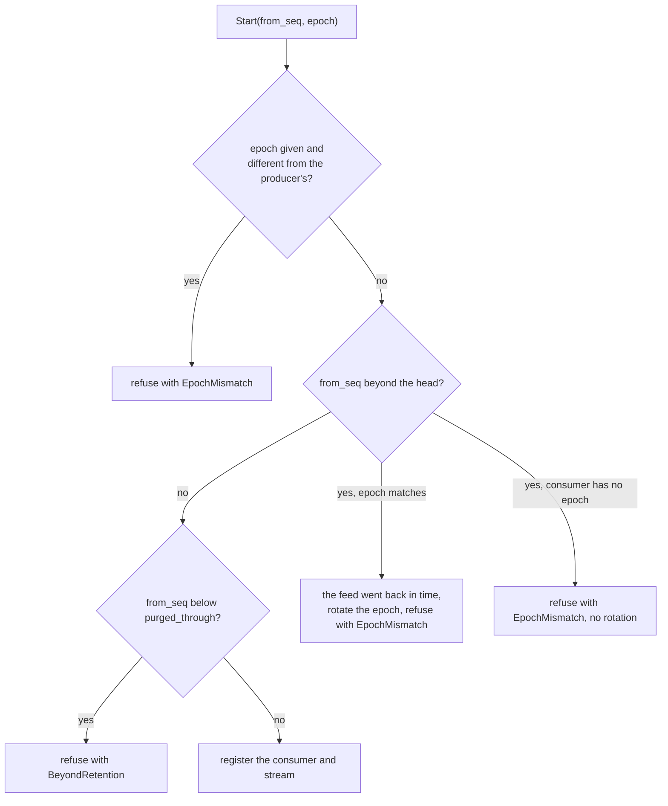

The epoch changes in two ways. An operator rotates it explicitly after restoring the producer, with `z-event-cli epoch rotate`, as part of the restore runbook. The producer also rotates it by itself when a consumer turns out to be ahead of the head, which can only happen after the feed went back in time. A rotation also ends streams that are already open, because every heartbeat checks the epoch again.

A subscriber that receives `EpochMismatch` stops and increments `feed_epoch_mismatch_total`. What to do with the data it derived from the lost events is a decision for the host, and docs/operating.md describes the usual procedure.

## 12. Ordering guarantees

| Scope | Guarantee | What handlers can rely on |
|---|---|---|
| One aggregate, for example `orders/o17` | Strict order, provided one producer owns the aggregate and changes to it are serialised by a row lock or equivalent | Apply in order, and still check `aggregate_version` during replays |
| One producer | Total order by position | Available, but nothing should depend on the order between different aggregates |
| Different producers | No global order | Projections must tolerate any arrival order, store versions and recompute derived values from current local state |

The last row matters in practice. A `PoaRevoked` event from one service and a `HearingChanged` event from another can arrive in either order, so a consumer that combines them recomputes its view from both current values rather than from the order in which the events arrived.

## 13. Storage ports

These are the storage traits, written here with `async fn` for readability. In the code every method is declared as `fn ... -> impl Future<Output = ...> + Send`, so the runtime can spawn the futures on a multi-threaded executor, and implementors simply write `async fn`.

```rust
/// The adapter's native transaction. The host writes its business data through it too.
pub trait Store: Send + Sync + 'static {
    type Tx: Send + 'static;                                   // dropping it rolls back
    type Error: std::error::Error + Send + Sync + 'static;
    async fn begin(&self) -> Result<Self::Tx, Self::Error>;
    async fn commit(&self, tx: Self::Tx) -> Result<(), Self::Error>;
    async fn rollback(&self, tx: Self::Tx) -> Result<(), Self::Error>;       // default drops
    async fn begin_snapshot(&self) -> Result<Self::Tx, Self::Error>;         // default begin
}

/// The producer side.
pub trait OutboxStore: Store {
    type Lease: Send + Sync + 'static;                         // dropping it without release is a crash
    async fn append(&self, tx: &mut Self::Tx, events: &[NewEvent]) -> Result<(), Self::Error>;
    async fn try_lead(&self) -> Result<Option<Self::Lease>, Self::Error>;
    async fn release(&self, lease: Self::Lease) -> Result<(), Self::Error>;
    async fn sequence_batch(&self, lease: &Self::Lease, limit: u32) -> Result<Option<Seq>, Self::Error>;
    async fn read(&self, after: Seq, types: &TypeFilter, limit: u32) -> Result<Vec<Event>, Self::Error>;
    async fn head(&self) -> Result<FeedHead, Self::Error>;     // seq, epoch, purged_through
    async fn rotate_epoch(&self) -> Result<Epoch, Self::Error>;
    fn notifications(&self) -> BoxStream<'static, Notification>;
    async fn unsequenced(&self) -> Result<u64, Self::Error>;
    async fn register_consumer(&self, consumer: &str, at: Seq) -> Result<(), Self::Error>;
    async fn ack(&self, consumer: &str, seq: Seq) -> Result<(), Self::Error>;
    async fn consumers(&self) -> Result<Vec<ConsumerState>, Self::Error>;
    async fn remove_consumer(&self, consumer: &str) -> Result<(), Self::Error>;
    async fn purge(&self, before: OffsetDateTime) -> Result<u64, Self::Error>;
}

/// The consumer side. Cursors and parked events are keyed by consumer and producer.
pub trait CursorStore: Store {
    async fn lock_cursor(&self, tx: &mut Self::Tx, key: &CursorKey) -> Result<Cursor, Self::Error>;
    async fn advance(&self, tx: &mut Self::Tx, key: &CursorKey, to: Cursor) -> Result<(), Self::Error>;
    async fn cursor(&self, key: &CursorKey) -> Result<Cursor, Self::Error>;
    async fn reset_cursor(&self, key: &CursorKey, to: Cursor) -> Result<(), Self::Error>;
    async fn park(&self, tx: &mut Self::Tx, letter: &DeadLetter) -> Result<(), Self::Error>;
    async fn is_parked(&self, tx: &mut Self::Tx, key: &CursorKey, aggregate: &str) -> Result<bool, Self::Error>;
    async fn parked(&self, key: &CursorKey, filter: &ParkedFilter) -> Result<Vec<DeadLetter>, Self::Error>;
    async fn resolve(&self, tx: &mut Self::Tx, key: &CursorKey, seq: Seq) -> Result<(), Self::Error>;
}

/// The host's business logic for one subscription.
pub trait Handler<S: Store>: Send + Sync + 'static {
    async fn handle(&self, tx: &mut S::Tx, event: &Event) -> Result<(), HandlerError>;
}
```

A few promises are worth calling out. `sequence_batch` must fail when the lease was lost and must renew it, and the producer calls it at least once per safety interval, so a lease must live at least three times that interval. `notifications` yields hints that may be coalesced or lost, and on overflow it yields `Lagged` instead of dropping silently. `lock_cursor` behaves like `SELECT ... FOR UPDATE`, so a second locker waits and then sees the committed value. `is_parked` must see the transaction's own writes. `purge` deletes the longest acknowledged prefix that is older than the cut-off and below the head.

Store errors and handler errors are kept apart. A store error before or around the handler drops the stream and the subscriber reconnects, and because the cursor did not move the event comes back. Handler errors and commit errors count as attempts in the retry and parking logic. Public runtime errors box store errors, so they are not generic over the adapter.

The logical data model has five tables or collections, split between the producer's storage and the consumer's storage.

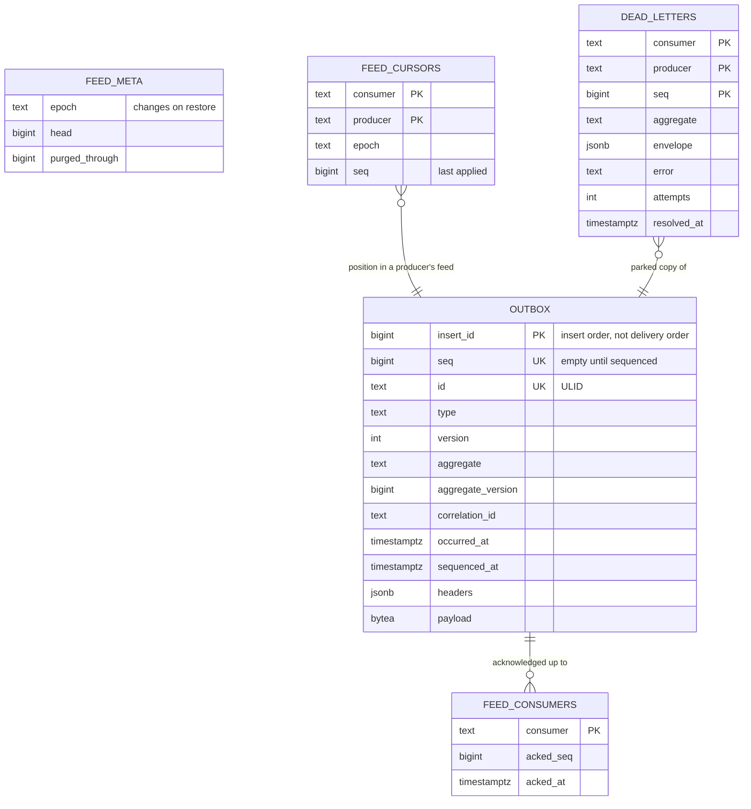

`OUTBOX`, `FEED_META` and `FEED_CONSUMERS` belong to the producer. `FEED_CURSORS` and `DEAD_LETTERS` belong to the consumer.

## 14. Transport port and the in-process transport

The transport port is small, because the protocol logic lives in the core.

```rust
pub trait Transport: Send + Sync + 'static {
    async fn subscribe(&self, producer: &str, start: Start) -> Result<Subscription, TransportError>;
    async fn snapshot(&self, producer: &str, request: SnapshotRequest) -> Result<MessageStream, TransportError>;
    async fn head(&self, producer: &str) -> Result<FeedHead, TransportError>;
}

pub struct Subscription {
    pub messages: MessageStream,   // events and checkpoints, in order
    pub acks: AckSender,           // the latest value wins and sending never blocks
}
```

`TransportError` is a single concrete type, so the subscriber can tell errors worth a reconnect from errors that must stop it. `Closed`, `Unavailable`, `UnknownProducer` and `Protocol` are retried. `PermissionDenied`, `EpochMismatch`, `BeyondRetention`, `Unsupported` and `InvalidRequest` stop the subscriber.

On the server side the core provides `FeedSource`, created with `Producer::feed_source(acl)`. A transport adapter maps its wire format to four calls. `open` handles a new subscription, `on_ack` records acknowledgements, `head` reports the feed's position and `snapshot` serves the producer's current state when a `Snapshotter` is configured with `with_snapshotter`. The order of checks in `open` is fixed. It verifies that the consumer name equals the caller's identity, that the access control list allows every explicitly requested type, that the epoch matches, and that the position is not below retention. Only then does it register the consumer and start the stream.

The in-process transport, `z_event::InProcess`, is a registry of feed sources keyed by producer name. Each subscription runs its feed stream on its own task behind a bounded channel of 64 messages, so a slow consumer applies backpressure exactly as it would over a network, and a second task forwards acknowledgements.

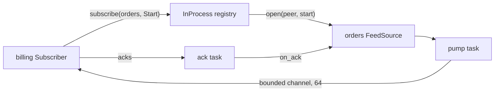

The caller's identity in-process is the consumer name, because both sides run in one trusted process, unless it is pinned with `as_peer`.

## 15. Postgres adapter (`z-event-postgres`)

`PgStore` implements all storage ports on PostgreSQL with sqlx 0.8, the same version as z-auth, so a host can share one transaction type between both libraries. `Store::Tx` is `sqlx::Transaction<'static, Postgres>`, and the host runs its own SQL on the same transaction.

Each service keeps the z-event tables in its own schema, next to its business tables, and several services can share one database and one connection pool. Statements are schema-qualified, so they do not depend on the connection's `search_path`. A schema name is a plain identifier of at most 40 characters.

```rust
let store = z_event_postgres::migrate(&pool, "orders").await?;
```

Migrations are embedded in the crate and recorded in their own history table, `zevent_migrations`, so they never clash with the host's migrations. A transaction-scoped advisory lock serialises migrations, so several replicas can run them at startup.

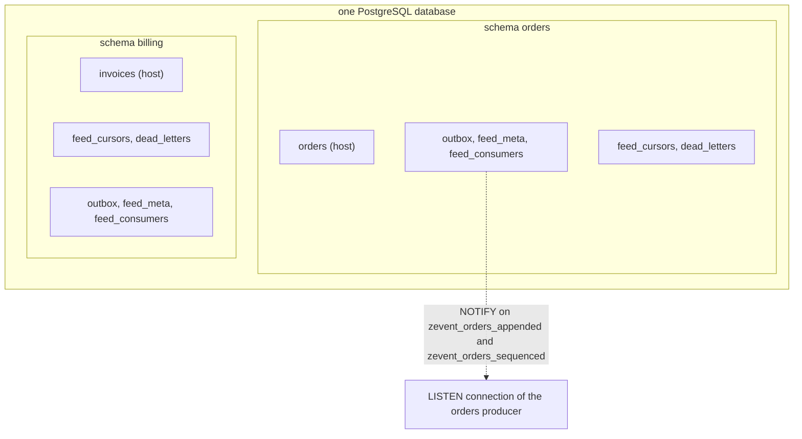

Appending is an `INSERT` with an empty position. An `AFTER INSERT` statement trigger calls `pg_notify('zevent_<schema>_appended', '')`, which PostgreSQL delivers on commit and folds into one notification per transaction. Channel names include the schema because notification channels are shared by the whole database.

The sequencer lease is a session advisory lock, `pg_try_advisory_lock`, on a dedicated connection that belongs to the lease, keyed by a hash of the schema name. The stamping statement runs on that same connection, so if the connection is gone the lock is gone and the statement fails, which is the fencing. Dropping the lease closes the connection, so a crashed process releases leadership too.

```sql
WITH meta AS (SELECT head FROM feed_meta FOR UPDATE),
batch AS (
    SELECT insert_id, row_number() OVER (ORDER BY insert_id) AS rn
    FROM (SELECT insert_id FROM outbox WHERE seq IS NULL ORDER BY insert_id LIMIT $1) pending
)
UPDATE outbox o
SET    seq = meta.head + batch.rn, sequenced_at = now()
FROM   batch, meta
WHERE  o.insert_id = batch.insert_id
RETURNING o.seq;
```

In the same transaction the sequencer moves `feed_meta.head` to the highest new position and calls `pg_notify('zevent_<schema>_sequenced', head)`. Uncommitted rows are invisible to the statement, so only committed rows are stamped. Two transactions on the same aggregate are serialised by the host's row lock, so the second outbox row is inserted after the first commits and is stamped after it. Numbering comes from `feed_meta.head`, so purging old rows never affects it.

Notifications come from a `PgListener` on both channels. It starts on a task as soon as `notifications()` is called, so hints are not lost before the stream is first polled, and a reconnect of the listener yields `Lagged`.

A cursor is created on first use and then locked with `SELECT ... FOR UPDATE`. Snapshots read through `begin_snapshot`, which sets `REPEATABLE READ READ ONLY`. Retention computes its boundary as the smallest of the head minus one, the lowest acknowledged position and the position just before the first event sequenced after the cut-off, deletes up to it and records it as `purged_through`.

The adapter uses runtime-checked queries only. Compile-time checked macros inside a library would check against the host's database at build time and break host builds.

PostgreSQL 13 and later are supported, as are compatible distributions with `LISTEN`, `NOTIFY` and advisory locks. The test suite runs on PostgreSQL 13 and 16.

## 16. gRPC adapter (`z-event-grpc`)

The gRPC adapter carries the protocol between processes. It fits into a host in whichever way the host already uses gRPC.

| Situation | API |
|---|---|
| The host already runs a tonic server with its own port, TLS and interceptors | `feed_service(source, identity)` returns a service to add with `Server::builder().add_service(...)` |
| The host already has a tonic `Channel` | `Client::new(channel)` implements the core `Transport` |
| The host has no gRPC setup | `serve_standalone(source, identity, addr, tls)` and `Client::connect(url, tls)` |
| A consumer written in another language | generate a client from `proto/zevent/v1/feed.proto` |

`Subscribe` is a bidirectional call. The consumer sends `Start` first and then acknowledgements, and the producer streams events and checkpoints on the same call.

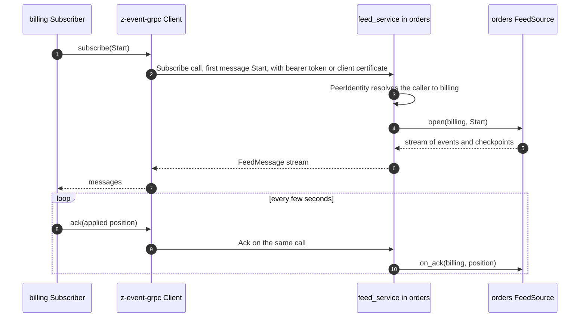

The caller's identity comes from a `PeerIdentity`. `MtlsIdentity` reads the client certificate, its common name by default or its first DNS name with `MtlsIdentity::dns_san()`, and is available with the default `tls` feature. `TokenIdentity` maps bearer tokens to peers, and the client sends its token with `Client::bearer_token`. `MetadataIdentity` takes a header as is, which is only appropriate in tests or behind a proxy that authenticates callers. Hosts can implement the trait themselves.

Errors map to status codes, and the details travel in response metadata so the client can rebuild the exact error.

| Status code | Meaning | Retried by the subscriber |
|---|---|---|
| `PERMISSION_DENIED` or `UNAUTHENTICATED` | identity mismatch or refused by the access control list | no |
| `FAILED_PRECONDITION` | epoch mismatch | no |
| `OUT_OF_RANGE` | position below the retention window | no |
| `INVALID_ARGUMENT` | malformed request | no |
| `UNIMPLEMENTED` | snapshots are not configured | no |
| `UNAVAILABLE` and any other code | storage or network failure | yes |

The standalone helpers and `Client::connect` enable HTTP/2 keep-alive with a 30 second interval and a 10 second timeout, and idle streams also carry heartbeat checkpoints every 15 seconds. The protobuf code is generated at build time with `tonic-prost-build` and `protox`, so no system `protoc` is needed and nothing generated is committed.

A client talks to the one producer its channel points at, so the producer name passed to the `Transport` methods is not sent over the wire.

```proto
syntax = "proto3";
package zevent.v1;

import "google/protobuf/timestamp.proto";

service EventFeed {
  rpc Subscribe(stream SubscribeMessage) returns (stream FeedMessage);
  rpc Snapshot(SnapshotRequest) returns (stream FeedMessage);
  rpc Head(HeadRequest) returns (HeadResponse);
}

message SubscribeMessage { oneof msg { Start start = 1; Ack ack = 2; } }
message Start { string consumer = 1; uint64 from_seq = 2; string epoch = 3; repeated string types = 4; }
message Ack { uint64 applied_seq = 1; }
message FeedMessage { oneof msg { Event event = 1; Checkpoint checkpoint = 2; } }
message Event {
  uint64 seq = 1;
  string id = 2;
  string type = 3;
  uint32 version = 4;
  string aggregate = 5;
  uint64 aggregate_version = 6;
  string correlation_id = 7;
  google.protobuf.Timestamp occurred_at = 8;
  map<string, string> headers = 9;
  bytes payload = 10;
}
message Checkpoint { uint64 seq = 1; uint64 head = 2; string epoch = 3; }
message SnapshotRequest { string consumer = 1; repeated string aggregate_types = 2; }
message HeadRequest {}
message HeadResponse { uint64 head = 1; string epoch = 2; uint64 purged_through = 3; }
```

The adapter is tested with the transport conformance suite over real HTTP/2, with a TCP proxy that keeps cutting connections, with mutual TLS using generated certificates, and with bearer tokens on a host-built server. `examples/split` runs `orders` and `billing` as two separate processes on PostgreSQL and gRPC.

## 17. Writing your own adapter

A new storage adapter implements `Store`, `OutboxStore` and `CursorStore` and documents how it satisfies the sequencing contract from section 6. A new transport adapter implements `Transport` on the client side and maps its wire format to `FeedSource` on the server side. Both kinds prove themselves with the conformance suites in `z-event-testkit`.

```rust
z_event_testkit::storage_suite!(|| async { MyStore::fresh().await });
z_event_testkit::transport_suite!(|| async { z_event_memory::MemoryStore::new() }, MyHarness);
```

The storage suite has 28 cases and the transport suite has 10. Among other things they commit 50 transactions concurrently in random order, crash the subscriber a thousand times at random points, kill the sequencer leader, cut streams repeatedly and bootstrap from snapshots. [docs/writing-an-adapter.md](docs/writing-an-adapter.md) explains every promise and how the suites check it.

## 18. Security and observability hooks

The host decides the security policy and z-event enforces it.

The transport establishes who is calling, and the consumer name in `Start` must equal that identity, so one service cannot read a feed under another service's name. Every feed has an `Acl` that answers whether a given peer may read a given event type. `TypeAcl` is a simple map from consumer to allowed types, and `AllowAll` exists for development. Explicitly requested types must all be allowed or the subscription is refused, and when a consumer requests no specific types it receives only the types it may read. z-event never inspects payloads or headers, so keeping personal data out of events is the producer's job.

Observability goes through the `metrics` facade and `tracing`. The metric names are constants in `z_event::telemetry`.

| Metric | Labels | Suggested alert |
|---|---|---|
| `feed_head_seq`, `feed_unsequenced_rows`, `feed_sequencer_leader` | producer | unsequenced rows above zero for more than 10 seconds, or no replica leading |
| `feed_appended_total`, `feed_purged_total`, `feed_streams_open` | producer | for dashboards |
| `feed_epoch_rotations_total` | producer | any increase |
| `feed_consumer_acked_seq` | producer, consumer | not moving for a long time |
| `feed_consumer_lag_events`, `feed_consumer_lag_seconds` | producer, consumer | lag above 60 seconds for 5 minutes |
| `feed_dead_letters` | producer, consumer | above zero |
| `feed_stream_reconnects_total`, `feed_epoch_mismatch_total` | producer, consumer | reconnect storms, or any epoch mismatch |
| `feed_events_applied_total`, `feed_handler_errors_total`, `feed_apply_seconds` | producer, consumer, and kind for errors | for dashboards |

Every applied event runs in a `z_event.apply` span carrying its position, id, type, aggregate and correlation id, so one trace connects the user's request with the effects in every consumer. The other spans are `z_event.append`, `z_event.producer`, `z_event.subscriber` and `z_event.bootstrap`.

## 19. Costs, limits and when to add a broker

Not having a broker has a cost. Producers keep their event history for the retention period and serve the streams themselves. At modest volume that is an indexed table and a few long-lived streams per service. The number of streams grows with producers times consumers, and tens to about a hundred streams are comfortable.

In return there is no clustered stateful system to install, secure, patch, back up, monitor and keep highly available. Database backups cover the events too, and one transport serves both requests and events.

These are the signs that a broker has become the better choice.

1. Systems outside your control need to consume the event stream directly.
2. Sustained volume reaches thousands of events per second per producer, or far more than a hundred streams.
3. The deployment becomes active-active across data centres.
4. The platform mandates a broker.

The migration path is contained. A new transport adapter relays the outbox into the broker and a broker-backed `Transport` reads from it. Handlers, event schemas, storage and the transactional guarantees stay as they are.

## 20. Patterns

A command can travel as an event when it has one intended consumer, for example `TaskRequested`. The producer generates the new record's id, returns it to its caller immediately and puts it into the event. The consumer creates the record with exactly that id, so the operation is idempotent and the caller has a correct id without waiting for the consumer.

A handler that must call an external system writes a job row in the same transaction as the cursor instead of calling out directly. A separate worker performs the job with the event id as idempotency key, with its own retries and alerting. The effect then leaves the service only from a committed row.

A projection that applies many small events uses `batch_size`, for example 100, so that many events share one transaction.

## 21. Out of scope (host responsibilities)

Some decisions stay with the host application, because they depend on the domain rather than on delivery.

Event schemas and their versioning belong to the host, as do the decisions about which services subscribe to which feeds and how a consumer finds a producer's address. The access policy, data minimisation and compliance rules are the host's, and so are deployment, TLS certificates, dashboards and alert rules, for which section 18 lists the signals.
