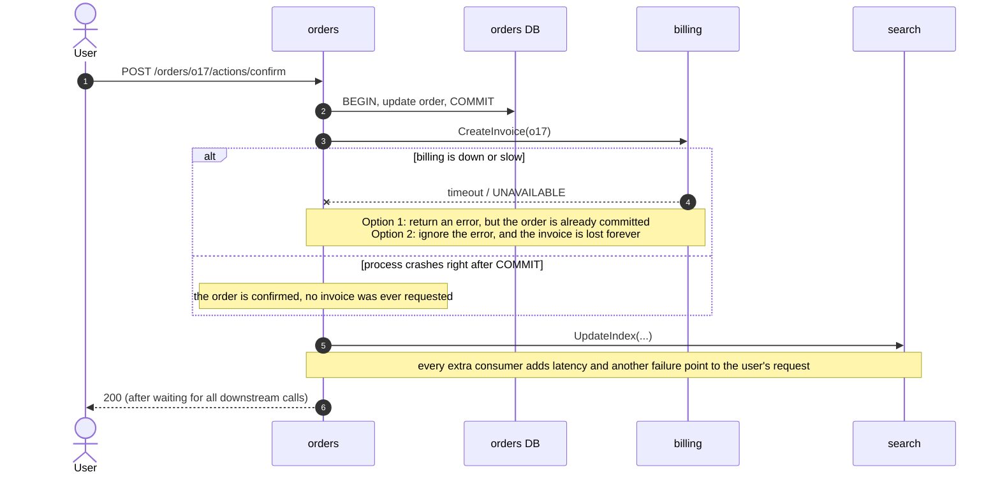
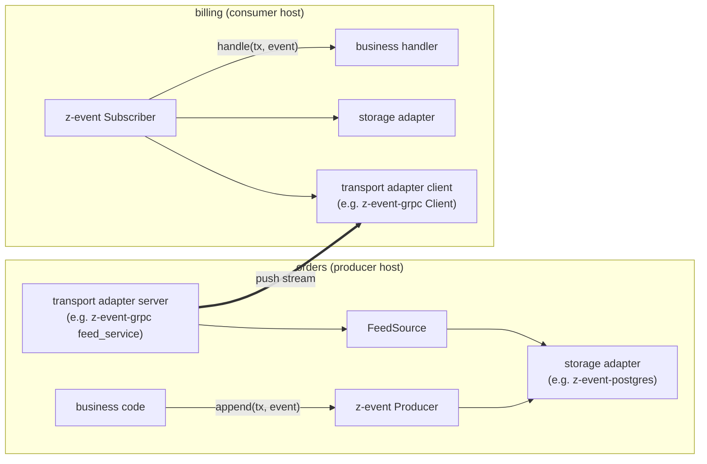
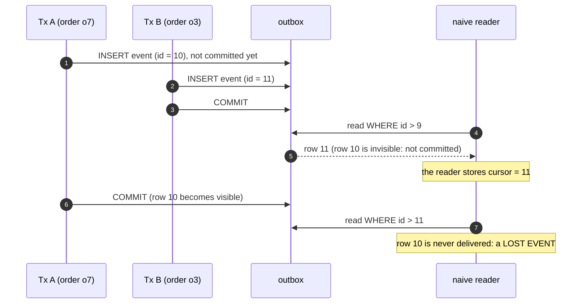
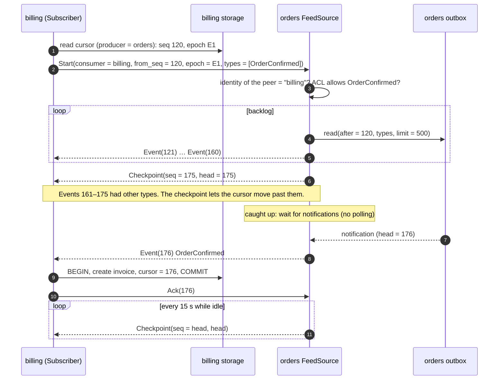
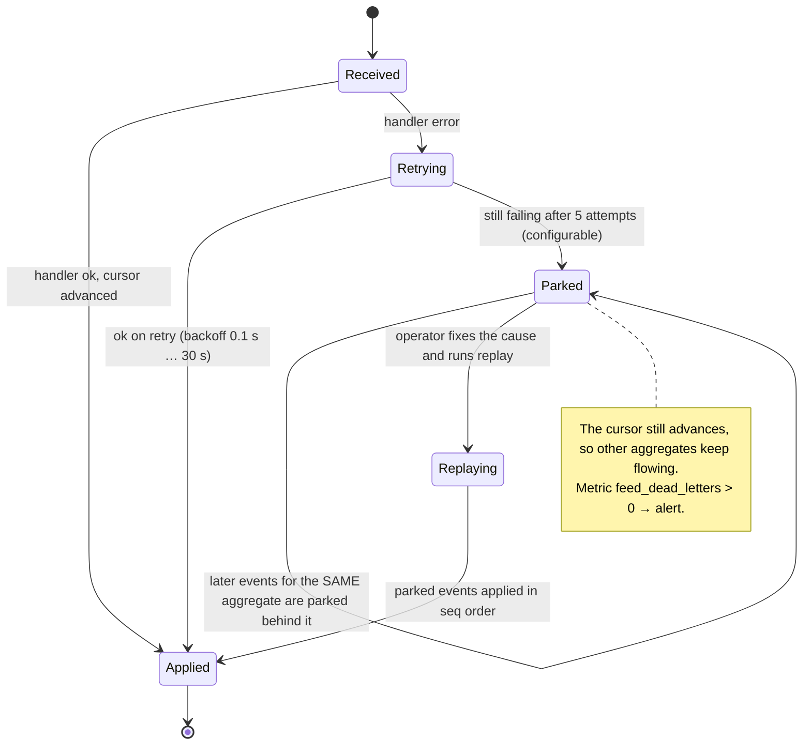
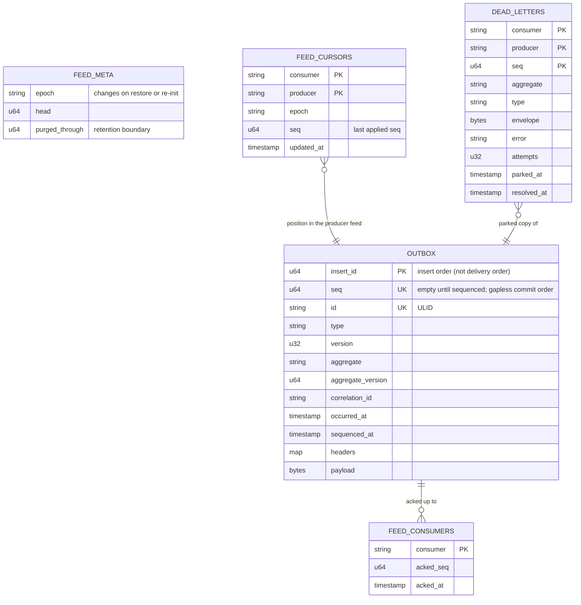

# z-event: design

> Status: **ZE1 and ZE2 implemented**: the core (`z-event`), the in-memory adapter (`z-event-memory`) and the conformance testkit (`z-event-testkit`). The Postgres and gRPC adapters are planned (ZE3, ZE4). The build order is in [`IMPLEMENTATION_PLAN.md`](IMPLEMENTATION_PLAN.md). Port signatures in §13–§14 are final as of ZE1.
>
> z-event is a Rust library for **reliable, push-based, event-driven communication between services without a message broker**. A producer writes events into its own database in the same transaction as the business change (a *transactional outbox*). It then serves that outbox as an ordered feed, and consumers subscribe to it. Each consumer stores its position (cursor) in the same transaction as the effect of the event, so nothing is lost and nothing is applied twice.
>
> The core is **database-agnostic and transport-agnostic**. Storage and network transport are **adapters** in `adapters/`. You use the ones we ship (Postgres, gRPC, in-memory) or write your own (e.g. MongoDB, HTTP/SSE).

Examples in this document use a neutral domain: an `orders` service produces events, and `billing`, `notifications` and `search` consume them.

---

## 1. The problem

A user action changes data in one service and must cause effects in others. For example, `POST /orders/{id}/actions/confirm` in **orders** must also:
- create an invoice in **billing**
- send an email via **notifications**
- update the search index in **search**.

The intuitive design is to commit to my database, then call the other services. It fails in several ways:



Calling **before** the commit is no better. If the transaction then rolls back, the invoice exists for an order that wasn't confirmed. This is the classic **dual-write problem**: two systems (my database and a network call) can't be updated atomically.

The fix always has the same core: **write the event into my own database, in the same transaction as the change, and deliver it afterwards**. The real question is only **what delivers the outbox afterwards**.

## 2. Requirements

| # | Requirement |
|---|---|
| R1 | **No event may be lost**, even if a consumer or the network is down |
| R2 | An event exists **only if** the business change committed (no phantom effects after a rollback) |
| R3 | The user's request does not wait for, or fail because of, downstream services |
| R4 | **Push**: consumers get events as they happen, without polling for them |
| R5 | One event can have many consumers; new consumers are added without changing the producer |
| R6 | Events about the same record arrive **in order** (v3 must not overwrite v4) |
| R7 | A consumer can **replay** history to rebuild its read model |
| R8 | Minimal infrastructure: only the databases the services already have, plus the services themselves |

## 3. Options considered

| Option | How the outbox is delivered | R1 | R3 | R4 | R5 | R7 | R8 | Verdict |
|---|---|---|---|---|---|---|---|---|
| **A. Sync calls** | Not delivered at all: direct calls in the request | ✗ | ✗ | ✓ | ✗ (producer knows every consumer) | ✗ | ✓ | Rejected (§1) |
| **B. Message broker** (Kafka / NATS JetStream / RabbitMQ) | A relay copies the outbox into the broker; consumers subscribe to the broker | ✓ | ✓ | ✓ or pull | ✓ | ✓ | ✗ an extra clustered stateful system to run, secure, back up and monitor | Viable, over-sized at modest volume (§19) |
| **C. Producer pushes (webhook style)** | The producer calls each consumer from the outbox, with retries | ✓ | ✓ | ✓ | ~ producer keeps subscriber lists and per-subscriber retry state | ~ | ✓ | Delivery state sits in the wrong place |
| **D. Consumer subscribes to the producer's feed** | The producer exposes its outbox as an ordered stream; consumers subscribe from their cursor and events are pushed as they commit | ✓ | ✓ | ✓ | ✓ the producer doesn't know who listens | ✓ re-subscribe from 0 | ✓ | **z-event** |

Option D is option C turned around: **the consumer owns its position (cursor), the producer only owns its log.** Producers keep no per-subscriber retry state, and "exactly-once effect" becomes almost free, because the consumer commits its cursor together with the effect (§8).

## 4. Architecture: core, ports and adapters

```
z-event/
├── core/                   # crate `z-event`: the protocol, Producer, Subscriber, ports (traits), in-process transport
│                           #   depends on: tokio, tokio-util, futures, serde, serde_json, bytes, thiserror,
│                           #   tracing, metrics, ulid, time, fastrand. NO database, NO gRPC
├── adapters/
│   ├── postgres/           # crate `z-event-postgres`: storage ports on PostgreSQL (sqlx)          [planned, ZE3]
│   ├── grpc/               # crate `z-event-grpc`: transport port on gRPC (tonic) + feed.proto     [planned, ZE4]
│   └── memory/             # crate `z-event-memory`: in-memory storage (reference implementation, tests, examples)
├── testkit/                # crate `z-event-testkit`: conformance suites for storage and transport adapters
└── examples/               # toy orders → billing: in-process (memory) and split (postgres + grpc)
```



**The dependency rule:** `core` never depends on an adapter. Adapters depend on `core` and implement its ports:

| Port (trait in core) | Implemented by | Purpose |
|---|---|---|
| `Store` + `OutboxStore` | storage adapter, on the producer side | append, sequence, read, notify, acks, purge (§13) |
| `Store` + `CursorStore` | storage adapter, on the consumer side | cursors, parking (§13) |
| `Transport` | transport adapter, client side | open a subscription to a producer (§14) |
| (server side) | transport adapter, server side | exposes the core `FeedSource` over the network (§14) |
| `Acl`, `Snapshotter` | the host (or the defaults `AllowAll`, `TypeAcl`) | who may read what; current state for bootstrap (§11, §18) |
| `PeerIdentity` | each transport adapter (it depends on the request type) | who is calling; core only defines the resulting `PeerId` (§16, §18) |

A service can be a producer, a consumer, or both. It may use different adapters on each side, but in practice one storage adapter per service is the norm.

**The in-process transport lives in core.** It uses tokio channels and has no dependencies, so a host can run several services in **one process** (dev, tests, small installs) with the same outbox, sequencer and subscriber code.

## 5. The envelope

| Field | Type | Meaning |
|---|---|---|
| `seq` | u64 | Position in the producer's feed: gapless, commit order (§6). Assigned by the sequencer, not by the writer |
| `id` | string (ULID) | Globally unique event id; the **idempotency key** for external side effects |
| `type` | string | e.g. `OrderConfirmed`. Used for subscription filters and ACLs |
| `version` | u32 | Payload schema version. Consumers accept N and N-1 during a rollout |
| `aggregate` | string | The record the event is about, e.g. `orders/o17`. The unit of ordering and parking |
| `aggregate_version` | u64 | Version of that record after the change. Lets handlers ignore stale or replayed events |
| `correlation_id` | string | The request id of the user action, for tracing across services |
| `occurred_at` | timestamp | When the business change happened |
| `headers` | map<string,string> | **Host-defined metadata**, e.g. `tenant`, `actor`, `entity`. z-event never interprets it |
| `payload` | bytes | Usually JSON of a typed event defined by the host. z-event never interprets it |

In Rust the `type` field is `Event::event_type` (serialised as `type`), and `correlation_id` is an `Option<String>` (empty on the wire means none).

z-event deliberately has **no event schema registry**. Hosts define their typed events (e.g. a shared `events` crate) and serialise them into `payload`.

## 6. Write path: the outbox and the commit-order gap

Every business transaction appends its events to the producer's outbox **through the storage adapter's transaction**, so R1 and R2 follow from the database's atomicity:

```rust
// host code: the business change and the event commit or roll back together
let mut tx = store.begin().await?;
orders::confirm(&mut tx, order_id).await?;                     // host SQL / documents on the same tx
producer.append(&mut tx, NewEvent::json("OrderConfirmed", format!("orders/{order_id}"), version, &payload)?
    .correlation(req_id)
    .header("tenant", tenant)).await?;
store.commit(tx).await?;
```

There is one subtle trap. **In most databases, insert-time ids are assigned in a different order from commit order.** A reader that streams "everything after id N" can silently skip an event:



**The fix: a sequencer.** Writers insert events with no `seq`. A single **sequencer** per producer (a leader, elected through a lease the storage adapter provides) stamps *committed* events with the next `seq` values. Uncommitted events are invisible to it, so an event gets its delivery number only **after** it committed. The feed is therefore gapless and append-only in delivery order, and readers never skip a row.

> **The sequencing contract** (every storage adapter must satisfy it, and the testkit checks it, §17):
> 1. `seq` values are assigned only to committed events.
> 2. `seq` is strictly increasing and **gapless** (1, 2, 3, …) within one epoch.
> 3. Once an event has a `seq`, it never changes, and no event is later inserted below the head.
> 4. Two events for the same aggregate get `seq` values in their commit order.

How the adapter meets the contract is adapter-specific: Postgres in §15, a MongoDB sketch in §17.

- **Latency.** The adapter's `notifications()` wakes the sequencer on commit. A typical commit → feed delay is a few milliseconds. A 1-second safety timer inside the producer covers a missed notification. That timer is producer housekeeping; **consumers never poll**.
- **Failover.** If the leader dies, its lease expires or is released, another replica acquires it, and continues from the head.

## 7. Delivery path: subscribe once, events are pushed

A consumer opens one **bidirectional stream** per producer. The protocol is defined in core, and transports only carry it:

| Direction | Message | Meaning |
|---|---|---|
| consumer → producer | `Start{consumer, from_seq, epoch, types}` | "I have applied up to `from_seq` (exclusive) in `epoch`; send me these types". `epoch` is empty on the first subscribe; empty `types` means every type the ACL lets this consumer read |
| consumer → producer | `Ack{applied_seq}` | Sent every few seconds. Feeds lag metrics and retention; delivery is **never gated** on acks |
| producer → consumer | `Event{…envelope…}` | One event, in `seq` order |
| producer → consumer | `Checkpoint{seq, head, epoch}` | Heartbeat and "skip" marker. Promise: every matching event with `seq` ≤ `Checkpoint.seq` was sent before it, so the cursor may move to `seq`. A stream always **opens** with a checkpoint at `from_seq`; it tells a new consumer the feed's epoch |

The producer's `FeedSource` streams the **backlog** (`seq > from_seq`, in batches, filtered by type) and then switches to **live push**. It waits on the storage adapter's `notifications()` and sends every new event the moment it is sequenced.



- **Type filters and the ACL.** Explicitly requested types must all pass the ACL, or the stream is refused. Without explicit types, events the ACL denies are skipped silently (the checkpoints still move the cursor past them).
- **No polling anywhere.** The producer wakes on notifications. The stream is long-lived, with `Checkpoint` heartbeats. A consumer only "pulls" once, on (re)connect, by stating its cursor.
- **Backpressure.** The `FeedSource` reads the backlog in batches and yields to the transport's flow control (HTTP/2 for gRPC, bounded channels in-process). A slow consumer never affects the producer's request path.

## 8. Consumer processing: effectively exactly-once

The stream is **at-least-once**: after a reconnect, the producer resends everything after the stored cursor. Duplicates are harmless because **the effect and the cursor are committed together**, in the consumer's storage adapter transaction:

```rust
// core: the Subscriber's apply step (simplified)
async fn apply(&self, ev: Event) -> Result<(), ApplyError> {
    let mut tx = self.store.begin().await?;
    let cursor = self.store.lock_cursor(&mut tx, &self.key).await?;      // exclusive per (consumer, producer)
    if ev.seq <= cursor.seq {
        return Ok(()); // already applied before a reconnect: skip (tx dropped = rolled back)
    }
    if self.store.is_parked(&mut tx, &self.key, &ev.aggregate).await? {
        self.store.park(&mut tx, &DeadLetter::behind(&self.key, &ev)).await?; // keep per-aggregate order (§10)
    } else {
        self.handler.handle(&mut tx, &ev).await?;                       // business effect, same tx
    }
    self.store.advance(&mut tx, &self.key, cursor.next(ev.seq)).await?;
    self.store.commit(tx).await?;                                       // effect + cursor atomically
    Ok(())
}
```

A handler error, or a failed commit, counts as one attempt; every retry runs in a fresh transaction (a failed SQL transaction cannot continue). If the cursor turns out to be *behind* the position the subscriber already committed (someone reset it), the subscriber reconnects from the stored cursor.

| Consumer kind | Example | Guarantee | How |
|---|---|---|---|
| **Pure DB effect** | billing creates an invoice; search updates its index table | **Exactly-once effect** | effect + cursor in one transaction. Projections may batch N events per transaction for speed |
| **External side effect** | notifications sends an email; a connector calls a third-party API | **At-least-once + idempotency** | the handler turns the event into a **job row** in the same transaction as the cursor; a worker executes the job with idempotency key = event `id`, backoff and an alert after N attempts |

The same rule holds on both sides: **nothing leaves a service except from a committed row.**

## 9. Failure scenarios

| Scenario | What happens | Result |
|---|---|---|
| **Consumer down** for minutes or days | The producer keeps appending, unaffected. The consumer restarts and subscribes from its cursor; the backlog streams at full speed, then live push resumes | No loss. Bounded only by retention (§11) |
| **Consumer crashes** mid-event | The transaction (effect + cursor) rolls back. On reconnect the event is resent | Applied exactly once |
| **Network drop** mid-stream | The Subscriber reconnects with exponential backoff + jitter, stating its cursor | Duplicates are skipped by `seq <= cursor` |
| **Producer down** | No new events can occur there anyway. Consumers retry the connection | Nothing to lose |
| **Sequencer leader dies** | Another replica acquires the lease and continues from the head | Seconds of extra delay, no gaps |
| **Slow consumer** | Transport backpressure; lag grows; the lag alert fires | Producer unaffected |
| **Poison event** (handler fails deterministically) | Retried with backoff, then **parked** (§10). Other aggregates keep flowing | Visible in metrics; fix the code, replay the parked events |
| **Producer storage restored from backup** | Detected through the epoch (§11). The consumer is stopped with an alert | No silent divergence; rebuild from a snapshot |

## 10. Poison events and parking

A handler returns either `HandlerError::Transient` (timeout, lock conflict) or `HandlerError::Permanent` (a bug, an unexpected payload). Transient errors are retried in place. Permanent errors (and transient ones that exceed the retry budget) must not block the whole stream. They also must not let later events for the **same aggregate** overtake the failed one. So the Subscriber **parks the aggregate, not the stream**:



Parked events live in the **consumer's** storage, through `CursorStore`. Replay is a core API, `Subscriber::replay_parked(filter)`, which `z-event-cli` and host admin endpoints wrap. It re-runs the handler for parked events in `seq` order, each in its own transaction with `resolve`.

## 11. Retention, replay, snapshots and epochs

- **Retention.** The producer's purge job deletes an outbox event when it was **sequenced** longer ago than the retention period (default 90 days) **and** every registered consumer has acked past it.
  - Purge removes a contiguous prefix of the feed and never the head event. The store remembers the boundary as `FeedHead.purged_through`.
  - A consumer whose cursor is below `purged_through` is refused with `BeyondRetention` and stops, instead of silently skipping purged events. It must bootstrap from a snapshot.
  - Only the replica that currently leads the sequencer purges.
  - Consumers register automatically on their first `Start`.
  - A consumer that stops acking blocks deletion and raises an alert, so nobody silently loses history.
  - Decommissioned consumers are removed explicitly (`z-event-cli consumers remove`).
- **Replay.** A consumer resets its cursor (to 0, or to a chosen seq) and re-subscribes. Handlers that check `aggregate_version` make a replay over already-applied data safe. Read models and search indexes are rebuilt this way.
- **A new consumer, or a rebuild beyond retention**, works in two steps:
  1. It calls `Snapshot`. The producer streams the current state of every requested aggregate as `<Type>Snapshot` events, provided by the host's `Snapshotter`, read in one consistent read, and ends with `Checkpoint(seq = S)`.
  2. The consumer subscribes from `S`. Changes committed while the snapshot was taken may arrive again after `S`, which is harmless thanks to `aggregate_version`.
- **Epochs.** Every feed has an `epoch` id, stored by the producer. A consumer's cursor records the epoch it belongs to. The producer refuses a `Start` whose epoch differs from its own, and the Subscriber stops with an alert. Epochs change:
  - **explicitly**, when an operator restores the producer's storage from a backup and runs `z-event-cli epoch rotate` (part of the restore runbook);
  - **automatically**, when a consumer's `from_seq` is **ahead** of the producer's head **in the producer's current epoch**: a sure sign the producer went back in time. The producer rotates the epoch and rejects the stream. A consumer with no epoch yet that is ahead of the head is rejected without rotating (nothing proves the feed went back).
  - A heartbeat re-reads the head, so a rotation also ends streams that are already open.

## 12. Ordering guarantees

| Scope | Guarantee | Consequence for handlers |
|---|---|---|
| One aggregate (e.g. `orders/o17`) | **Strict order**, provided one producer owns the aggregate and changes to it are serialised (row lock or equivalent) | Apply in order; still check `aggregate_version` during replays |
| One producer | **Total order** by `seq` | Free, but don't rely on order between different aggregates |
| Different producers | **No global order** | Projections tolerate any arrival order: store versions, recompute derived values from current local state, not from the event sequence |

## 13. Storage ports

Final as of ZE1. Every async method is declared as `fn …(…) -> impl Future<Output = …> + Send`, so the runtime can spawn the futures on a multi-threaded executor; implementors simply write `async fn` (no `async-trait`). The traits are therefore not dyn-compatible; the core is generic over them, and erases types internally where it must.

```rust
/// The adapter's native transaction. The HOST also uses it for its own business writes,
/// which is what makes "change + event" and "effect + cursor" atomic.
pub trait Store: Send + Sync + 'static {
    type Tx: Send + 'static;                                          // drop = rollback
    type Error: std::error::Error + Send + Sync + 'static;
    fn begin(&self) -> impl Future<Output = Result<Self::Tx, Self::Error>> + Send;
    fn commit(&self, tx: Self::Tx) -> impl Future<Output = Result<(), Self::Error>> + Send;
    fn rollback(&self, tx: Self::Tx) -> impl Future<Output = Result<(), Self::Error>> + Send; // default: drop
}

/// Producer side. Written with `async fn` for brevity; the trait declares `impl Future + Send`.
pub trait OutboxStore: Store {
    type Lease: Send + Sync + 'static;        // dropping it without release() = a crash
    async fn append(&self, tx: &mut Self::Tx, events: &[NewEvent]) -> Result<(), Self::Error>;
    async fn try_lead(&self) -> Result<Option<Self::Lease>, Self::Error>;
    async fn release(&self, lease: Self::Lease) -> Result<(), Self::Error>;
    /// Stamps committed, unsequenced events (sequencing contract, §6). MUST fail if the lease
    /// was lost (fencing) and MUST renew it. Returns the new head, if anything was stamped.
    async fn sequence_batch(&self, lease: &Self::Lease, limit: u32) -> Result<Option<Seq>, Self::Error>;
    async fn read(&self, after: Seq, types: &TypeFilter, limit: u32) -> Result<Vec<Event>, Self::Error>;
    async fn head(&self) -> Result<FeedHead, Self::Error>;            // {seq, epoch, purged_through}
    async fn rotate_epoch(&self) -> Result<Epoch, Self::Error>;
    /// Hints: Appended (wake the sequencer), Sequenced(head) (wake feeds), Lagged (re-check).
    fn notifications(&self) -> BoxStream<'static, Notification>;
    async fn unsequenced(&self) -> Result<u64, Self::Error>;          // stuck-sequencer signal
    async fn register_consumer(&self, consumer: &str, at: Seq) -> Result<(), Self::Error>;
    async fn ack(&self, consumer: &str, seq: Seq) -> Result<(), Self::Error>;   // monotonic
    async fn consumers(&self) -> Result<Vec<ConsumerState>, Self::Error>;
    async fn remove_consumer(&self, consumer: &str) -> Result<(), Self::Error>;
    /// Deletes the longest prefix sequenced before `before` AND acked by every registered
    /// consumer, never the head event; updates purged_through. Returns the count.
    async fn purge(&self, before: OffsetDateTime) -> Result<u64, Self::Error>;
}

/// Consumer side. Cursors and dead letters are keyed by CursorKey { consumer, producer }:
/// one service may run several consumers against one producer.
pub trait CursorStore: Store {
    /// Exclusive until the tx ends (SELECT … FOR UPDATE semantics); creates the row on first use.
    async fn lock_cursor(&self, tx: &mut Self::Tx, key: &CursorKey) -> Result<Cursor, Self::Error>;
    async fn advance(&self, tx: &mut Self::Tx, key: &CursorKey, to: Cursor) -> Result<(), Self::Error>;
    async fn cursor(&self, key: &CursorKey) -> Result<Cursor, Self::Error>;          // no lock
    async fn reset_cursor(&self, key: &CursorKey, to: Cursor) -> Result<(), Self::Error>;
    async fn park(&self, tx: &mut Self::Tx, letter: &DeadLetter) -> Result<(), Self::Error>; // upsert
    /// MUST see this transaction's own parks and resolves.
    async fn is_parked(&self, tx: &mut Self::Tx, key: &CursorKey, aggregate: &str) -> Result<bool, Self::Error>;
    async fn parked(&self, key: &CursorKey, filter: &ParkedFilter) -> Result<Vec<DeadLetter>, Self::Error>;
    async fn resolve(&self, tx: &mut Self::Tx, key: &CursorKey, seq: Seq) -> Result<(), Self::Error>;
}

/// Host business logic for one subscription.
pub trait Handler<S: Store>: Send + Sync + 'static {
    fn handle(&self, tx: &mut S::Tx, event: &Event) -> impl Future<Output = Result<(), HandlerError>> + Send;
}
pub enum HandlerError { Transient(BoxError), Permanent(BoxError) }
```

- **Leases.** The producer's sequencer calls `sequence_batch` at least once per safety interval (default 1 s), which renews the lease. A lease must therefore live at least three times the safety interval. If `sequence_batch` fails, the sequencer releases the lease and competes for it again.
- **Store errors and handler errors are separate.** A store error before or around the handler drops the stream and reconnects with backoff; the cursor did not move, so the event comes back. Handler errors and commit errors count as attempts (§8, §10). Public runtime errors box store errors (`SubscriberError::Store`, `FeedError::Unavailable`), so they are not generic.
- **Notifications are hints.** The producer opens one notification stream and fans it out to its sequencer and feed streams. A lost or lagged hint costs latency only: the sequencer has its safety timer, and each feed stream re-reads the head on its heartbeat.

**Logical data model** (an adapter may map it to tables, collections or anything else):



`OUTBOX`, `FEED_META` and `FEED_CONSUMERS` live in the producer's storage. `FEED_CURSORS` and `DEAD_LETTERS` live in the consumer's storage.

## 14. Transport port and the in-process transport

```rust
/// Client side: open a subscription to one producer.
pub trait Transport: Send + Sync + 'static {
    fn subscribe(&self, producer: &str, start: Start)
        -> impl Future<Output = Result<Subscription, TransportError>> + Send;
    fn snapshot(&self, producer: &str, request: SnapshotRequest)
        -> impl Future<Output = Result<MessageStream, TransportError>> + Send;
    fn head(&self, producer: &str) -> impl Future<Output = Result<FeedHead, TransportError>> + Send;
}
pub type MessageStream = BoxStream<'static, Result<FeedMessage, TransportError>>;  // Event | Checkpoint
pub struct Subscription {
    pub messages: MessageStream,
    pub acks: AckSender,          // latest value wins, never blocks
}
```

`TransportError` is a single concrete type, so the subscriber can tell errors worth a reconnect (`Closed`, `Unavailable`, `UnknownProducer`, `Protocol`) from errors that must stop it (`PermissionDenied`, `EpochMismatch`, `BeyondRetention`, `Unsupported`, `InvalidRequest`): `TransportError::is_retryable()`.

**Server side**, core provides `FeedSource<S: OutboxStore>` (from `Producer::feed_source(acl)`):
- `open(peer: &PeerId, start: Start) -> Result<FeedStream, FeedError>` does, in order: the identity check (`start.consumer == peer`), the ACL check for explicitly requested types, the epoch check (§11), the retention check, and registers the consumer. The stream is pull-based (the transport's flow control is the backpressure; dropping it cancels it): the opening checkpoint, the backlog in batches (default 500) with skip checkpoints, then live push, with heartbeats every 15 s when idle.
- `on_ack(peer, ack)`, `head()`, and `snapshot(peer, request)`: the host's `Snapshotter` (set with `with_snapshotter`) produces `*Snapshot` events, read in one transaction begun after the head `S` was read; they carry `seq = S` and end with `Checkpoint(S)`.

A transport adapter only maps its wire format to these calls. That is why a new transport (HTTP/SSE, WebSocket, a broker relay) is small.

**In-process transport** (`z_event::InProcess`, in core): a registry of `FeedSource`s keyed by producer name. `subscribe` calls `open` directly and runs the feed stream on its own task behind a bounded channel (64 messages), so a slow consumer applies backpressure as it would over a network; a second task forwards acks. The peer is the consumer name (both sides run in one process), unless pinned with `as_peer`. Hosts use it to run several services in one process, and most tests use it.

## 15. Postgres adapter (`z-event-postgres`)

- **Types.** `Store::Tx = sqlx::Transaction<'static, Postgres>`. The host runs its business SQL on the same transaction.
- **Tables.** `outbox`, `feed_meta`, `feed_consumers`, `feed_cursors`, `dead_letters`, with indexes on `outbox(seq)`, a partial index `outbox(insert_id) WHERE seq IS NULL`, and `outbox(aggregate)`.
  - They ship as **embedded migrations**: `z_event_postgres::migrate(&pool)`, with their own migration history table, so they never clash with the host's migrations.
  - Table names are **unqualified**, so a host that keeps one schema per service runs them in each schema via `search_path`.
- **Append** is an `INSERT … seq = NULL`. An `AFTER INSERT … FOR EACH STATEMENT` trigger calls `pg_notify(<channel>_appended, '')`, which Postgres delivers **on commit**.
  - **Channel names** default to `zevent_<current_schema>`, because NOTIFY channels are database-wide and several services may share one database.
- **Leader lease:** `pg_try_advisory_lock(<key derived from schema>)` on a dedicated connection. If the connection dies, the lock is released and another replica takes over.
- **Sequencer**: one leader, so `max + row_number` is safe:

  ```sql
  WITH batch AS (
      SELECT insert_id, row_number() OVER (ORDER BY insert_id) AS rn
      FROM outbox
      WHERE seq IS NULL
      ORDER BY insert_id
      LIMIT $1
  )
  UPDATE outbox o
  SET    seq          = (SELECT coalesce(max(seq), 0) FROM outbox) + batch.rn,
         sequenced_at = now()
  FROM   batch
  WHERE  o.insert_id = batch.insert_id
  RETURNING o.seq;   -- the max is published with pg_notify(<channel>_sequenced, head)
  ```

  Uncommitted rows are invisible to this statement, so only committed rows are stamped (contract §6, rules 1–3). Two transactions on the same aggregate are serialised by the host's row lock, so the second outbox row commits after the first and is stamped after it (rule 4).

  The `max(seq)` read stays correct after purge, because purge never deletes the head row; `feed_meta.head` is the fallback.
- **Notifications:** a `PgListener` (a dedicated connection) on both channels, plus the 1-second safety timer.
- **Cursors:** `lock_cursor` = `SELECT … FOR UPDATE` on `feed_cursors(consumer, producer)`; it inserts the row on first use.
- **Rule: runtime-checked queries only** (`sqlx::query`, `query_as`), **never the `query!` macros.** Macros inside a dependency would compile-check against the *host's* `DATABASE_URL` and break host builds. Correctness comes from the conformance suite running against a real Postgres (testcontainers).
- **Compatibility:** PostgreSQL 13+, and Postgres-compatible distributions that support `LISTEN/NOTIFY` and advisory locks.

## 16. gRPC adapter (`z-event-grpc`)

**Shape: pluggable + turnkey.**

| Use case | API |
|---|---|
| The host already runs a tonic server (its own TLS/mTLS, interceptors, port) | `z_event_grpc::feed_service(source, identity)` returns a tonic service; the host adds it with `Server::builder().add_service(..)` |
| The host already has a `tonic::transport::Channel` | `z_event_grpc::Client::new(channel)` implements the core `Transport` |
| The host has no gRPC setup | `z_event_grpc::serve_standalone(source, addr, ServerTls)` and `Client::connect(url, ClientTls)` |
| A non-Rust consumer | generate a client from `proto/zevent/v1/feed.proto` |

```rust
// producer host that already serves gRPC
Server::builder()
    .tls_config(my_mtls)?
    .add_service(my_other_service)
    .add_service(z_event_grpc::feed_service(producer.feed_source(acl), MtlsIdentity::default()))
    .serve(addr).await?;

// consumer host
let channel = Endpoint::from_static("https://orders:50051").tls_config(my_mtls)?.connect().await?;
Subscriber::builder(store, z_event_grpc::Client::new(channel), InvoiceHandler)
    .consumer("billing").producer("orders").types(["OrderConfirmed"])
    .spawn();
```

- **Peer identity.** The `PeerIdentity` trait lives in this adapter, because it depends on the request type; it yields the core's `PeerId`. The default `MtlsIdentity` reads the client certificate subject (CN or a SAN). Hosts may override it, e.g. with a signed token in request metadata.
- **Code generation** (decided in ZE1, built in ZE4): `tonic-build` with `protox` at build time, so no system `protoc` is needed.
- **Errors map to gRPC status codes:**
  - `PERMISSION_DENIED`: the identity doesn't match, or the ACL refuses;
  - `FAILED_PRECONDITION`: epoch mismatch, or a start below the retention window;
  - `UNAVAILABLE`: the store is unreachable; the Subscriber retries.
- **Keep-alive.** HTTP/2 keep-alive plus `Checkpoint` heartbeats every 15 s.

```proto
// adapters/grpc/proto/zevent/v1/feed.proto
syntax = "proto3";
package zevent.v1;

import "google/protobuf/timestamp.proto";

service EventFeed {
  // Bidirectional: the consumer opens with Start and then sends periodic Acks.
  // The producer pushes the backlog in seq order, then live events as they are sequenced.
  rpc Subscribe(stream SubscribeMessage) returns (stream FeedMessage);
  // Current state of aggregates as *Snapshot events, ending with a Checkpoint (§11).
  rpc Snapshot(SnapshotRequest) returns (stream FeedMessage);
  rpc Head(HeadRequest) returns (HeadResponse);
}

message SubscribeMessage { oneof msg { Start start = 1; Ack ack = 2; } }
message Start {
  string consumer = 1;          // must match the caller's identity
  uint64 from_seq = 2;          // last applied seq (exclusive)
  string epoch = 3;             // epoch of that cursor; empty on first subscribe
  repeated string types = 4;    // type filter, checked against the ACL
}
message Ack { uint64 applied_seq = 1; }

message FeedMessage { oneof msg { Event event = 1; Checkpoint checkpoint = 2; } }
message Event {
  uint64 seq = 1;
  string id = 2;                         // ULID (idempotency key)
  string type = 3;
  uint32 version = 4;
  string aggregate = 5;
  uint64 aggregate_version = 6;
  string correlation_id = 7;
  google.protobuf.Timestamp occurred_at = 8;
  map<string, string> headers = 9;       // host-defined metadata
  bytes payload = 10;                    // host-defined (usually JSON)
}
// Heartbeat and "skip" marker: lets the cursor move past filtered-out ranges.
message Checkpoint { uint64 seq = 1; uint64 head = 2; string epoch = 3; }

message SnapshotRequest { string consumer = 1; repeated string aggregate_types = 2; }
message HeadRequest {}
message HeadResponse { uint64 head = 1; string epoch = 2; uint64 purged_through = 3; }
```

## 17. Writing your own adapter

1. Implement `Store` + `OutboxStore` and/or `Store` + `CursorStore` (storage), or `Transport` plus a server that exposes `FeedSource` (transport).
2. Document how you satisfy the **sequencing contract** (§6).
3. Run the **conformance suites** from `z-event-testkit` in your adapter's tests. The macros generate one multi-threaded `#[tokio::test]` per case; `storage::run_all` and `transport::run_all` run them in one test, and every case is also a public function.

   ```rust
   // storage adapter: the factory returns a NEW, EMPTY storage per call (for SQL: a new schema)
   z_event_testkit::storage_suite!(|| async { MyStore::fresh().await });

   // transport adapter: implement TransportHarness (serve a FeedSource, return a client for a peer)
   z_event_testkit::transport_suite!(|| async { MemoryStore::new() }, MyHarness);
   ```

   The store under test implements both `OutboxStore` and `CursorStore`: test handlers record their effects by appending to the consumer store's own outbox, in the handler's transaction, so effects are atomic with the cursor and countable through the ports alone. `ZEVENT_TESTKIT_SEED` fixes the random seed (printed on every run); `ZEVENT_TESTKIT_SCALE` multiplies iteration counts.

   | Suite | Checks |
   |---|---|
   | `storage` (24 cases) | the sequencing contract: commit-order gap (50 concurrent transactions with random commit delays, some held open, some rolled back, a live reader), gapless and immutable `seq`, only committed events sequenced; read contract and envelope round trip; exclusive leases and cursor locks; parking visibility; purge respects acks and keeps the head; epochs and notifications; consumer outage (exactly once); duplicates after reconnect skipped; concurrent subscribers of one consumer; crash mid-apply ×1000 (a handler that hangs at planned points, a store that crashes right before or after its N-th operation, and random aborts: effect and cursor never diverge); sequencer failover (crash < 5 s, graceful < 2 s, no gaps); poison and transient failures → park → per-aggregate blocking → replay; filtered checkpoints; epoch mismatch (three variants); retention boundary; cursor reset |
   | `transport` (9 cases) | network drops in a loop (no loss, no duplicate effects); identity and ACL enforced; backpressure with a slow consumer; heartbeats; reconnect with exponential backoff and jitter; acks reach the producer; ordered delivery and checkpoint promise; head and snapshot |

**Sketch: a MongoDB storage adapter**
- `Tx` = a `ClientSession` with a multi-document transaction (requires a replica set).
- `append` inserts into an `outbox` collection with `seq: null`.
- The leader lease is a document with `owner` + `expires_at`, renewed periodically, with fencing by lease version.
- `sequence_batch` reads `seq: null` documents ordered by `_id`. It skips none that are visible, because Mongo transactions make documents visible atomically on commit. It stamps them from a counter document inside one transaction with the lease check.
- `notifications()` uses a change stream on `outbox`.
- The conformance suite decides whether this sketch is correct.

## 18. Security and observability hooks

**Security** (the host decides the policy; z-event enforces it):
- **Identity** comes from the transport (`PeerIdentity`; mTLS for gRPC). The consumer name in `Start` must equal it.
- **`Acl`** answers "may this peer read events of this type?". The default `AllowAll` is for dev only; hosts provide a config-driven ACL.
- **Data minimisation** is the producer's job: z-event never inspects `payload` or `headers`.

**Observability** (the `metrics` facade + `tracing`):

| Metric | Suggested alert |
|---|---|
| `feed_head_seq{producer}`, `feed_unsequenced_rows{producer}`, `feed_sequencer_leader{producer}` | unsequenced > 0 for more than 10 s (sequencer stuck); no replica leading |
| `feed_consumer_lag_events{producer,consumer}`, `feed_consumer_lag_seconds{…}` (now − `occurred_at` of the last applied event) | lag > 60 s for 5 min |
| `feed_dead_letters{producer,consumer}` | > 0 |
| `feed_stream_reconnects_total`, `feed_epoch_mismatch_total`, `feed_epoch_rotations_total` | reconnect storms; any epoch mismatch or rotation |
| `feed_appended_total`, `feed_purged_total`, `feed_streams_open`, `feed_consumer_acked_seq`, `feed_events_applied_total`, `feed_handler_errors_total{kind}`, `feed_apply_seconds` | dashboards |

Metric names are constants in `z_event::telemetry`. Spans: `z_event.append`, `z_event.producer`, `z_event.subscriber`, `z_event.apply` (with `seq`, `event_id`, `event_type`, `aggregate`, `correlation_id`).

The handler span is linked to the producer's request through `correlation_id`, so one trace shows the whole flow from the user's action to the last effect.

## 19. Costs, limits and when to add a broker

**What you pay for not having a broker:**
- Producers keep event history (retention) and serve streams. At modest volume this is an indexed table and a few long-lived streams per service.
- Connections grow as producers × consumers. Tens to about a hundred streams are fine.

**What you gain:**
- No extra clustered stateful system to install, secure, patch, back up, monitor and keep highly available.
- Database backups cover the events too.
- One transport for everything internal.

**Signs you have outgrown it:**
1. External systems need to consume your event stream directly.
2. Sustained volume of thousands of events per second per producer, or far more than ~100 streams.
3. Active-active deployment across data centres.
4. The platform mandates a broker.

**The migration path is contained:** write a transport adapter that relays the outbox into the broker, plus a broker-backed `Transport`. Handlers, event schemas, storage and the transactional guarantees stay the same.

## 20. Patterns

**Commands as events, with pre-allocated ids.** "Please create a task" is a command with one intended consumer, but it can travel through the same feed (`TaskRequested`). The producer generates the new record's id (`ulid()`), returns it to its caller immediately, and puts it in the event. The consumer creates the record with exactly that id, idempotently. The caller gets a correct id without waiting for the consumer.

## 21. Out of scope (host responsibilities)

- Event schemas and their versioning (`type` + `version` + `payload`).
- Which services subscribe to which feeds, and how producers are discovered (config).
- ACL policy, data minimisation, compliance requirements.
- Deployment, TLS certificates, dashboards and alert rules (§18 gives the signals).
