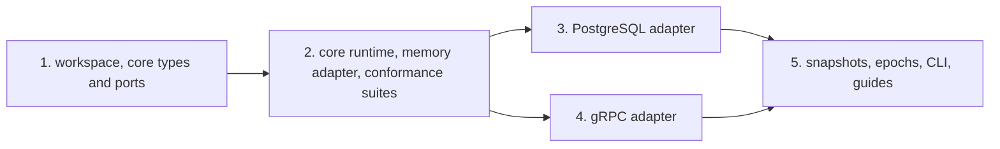

# z-event build plan and status

This document records how z-event was built, in which order and why, and what remains to be done. The architecture is described in [DESIGN.md](DESIGN.md).

## Approach

The guiding rule was to prove that the core is independent of any database before touching a real one. The core and the in-memory adapter had to pass the full conformance suite first. Only then did the PostgreSQL and gRPC adapters arrive, and they had to pass the same suite unchanged.

Every milestone had the same definition of done. Formatting, clippy with warnings as errors, cargo-deny and the tests pass in CI. The core depends on no adapter, database driver or gRPC library, which a script checks. Public types carry documentation with an example, and every adapter runs the full conformance suite in its own tests.

## Milestones

All five milestones are complete. The internal code of each milestone, written as ZE1 to ZE5, appears in the history of this file and in older discussions.

### 1. Workspace, core types and ports

The Cargo workspace, CI, licences and tooling were set up first. The core received its data types, the envelope, positions, filters, parked events and the protocol messages, and the traits for storage, handlers, transport, access control and snapshots.

The traits use native async methods declared as `impl Future + Send`, so implementors write plain `async fn` and the runtime can spawn the futures on a multi-threaded executor. A documentation test implements every trait with a dummy store to prove that this works.

### 2. Core runtime, memory adapter and conformance suites

This was the critical milestone. The core gained the producer with its sequencer and retention job, the feed source with backlog, checkpoints, live push and heartbeats, the subscriber with exactly-once application, retries, parking, replay and reconnects, and the in-process transport, metrics and tracing.

The in-memory adapter stages writes in each transaction and applies them atomically on commit, with insert ids taken at append time, so the commit-order gap exists in memory too and the conformance tests mean something.

The conformance suites were then written and checked against deliberately planted bugs. Removing the duplicate check, committing effect and cursor separately, skipping events in full backlog batches, sequencing uncommitted rows and three different mistakes in batched application each make at least one case fail.

Several design details were settled during this milestone and recorded in DESIGN.md. Cursors are keyed by consumer and producer, the transport has a single error type, every stream opens with a checkpoint that carries the epoch, leases are fenced and renewed, and retention records a boundary so that a consumer below it is refused instead of silently skipping events.

### 3. PostgreSQL adapter

The adapter uses sqlx 0.8, the same version as z-auth, so a host can share one transaction type between both libraries. Statements are schema-qualified, migrations are embedded, and the sequencer lease is an advisory lock on a dedicated connection that also runs the stamping statement.

The storage suite passes on PostgreSQL 13 and 16 in containers, and the transport suite passes on PostgreSQL 16. Separate tests cover two schemas in one database, concurrent migrations, business writes sharing the event's transaction and a dropped lease freeing leadership.

One finding changed the test kit. With a networked database, a task that is killed after sending `COMMIT` can still have its transaction committed afterwards. The crash test now reads the cursor under a lock, so it compares effects and cursor only after any in-flight transaction has finished.

### 4. gRPC adapter

The adapter uses tonic 0.14 and generates its code with protox, so no system `protoc` is needed. It offers a feed service for a host's existing server, a client for a host's existing channel, standalone helpers, and identities based on client certificates, bearer tokens or a trusted header.

The transport suite passes over real HTTP/2. Delivery is exactly once through a TCP proxy that keeps cutting connections, mutual TLS and bearer tokens are tested, and the commit to applied latency is below one millisecond at the 95th percentile on a laptop, against a target of 100 milliseconds. A two-process example runs `orders` and `billing` on PostgreSQL and gRPC, and its test starts both binaries.

### 5. Snapshots, epochs, CLI and guides

Subscribers can bootstrap from the producer's snapshot when they are new or have fallen below the retention window. Snapshots read through a consistent read-only transaction. Epoch rotation and detection were already covered, and the restore procedure is documented in the operations guide.

The `z-event-cli` tool inspects and repairs feeds, consumers, parked events, cursors and epochs. Its commands form a library, so a service can mount them in its own binary together with its subscriber, which is what replaying parked events requires.

The operations guide and the adapter guide complete the milestone.

## Current numbers

| Item | Count |
|---|---|
| Storage conformance cases | 28 |
| Transport conformance cases | 10 |
| Tests in the workspace under nextest | 97 |
| PostgreSQL versions under test | 13 and 16 |

## Risks and how they were handled

| Risk | Impact | Mitigation |
|---|---|---|
| The ports carry PostgreSQL assumptions | Another storage adapter would be hard to write | The memory adapter was built first and passes the full suite |
| Subtle delivery bugs such as gaps, duplicates or stalls | Lost or doubled effects in host systems | The sequencer by design, conformance suites with concurrency and crash tests in CI, and alerts on lag and unsequenced rows |
| Generic traits make the API hard to use | Hosts wrap it inconsistently | Examples first, builders with defaults and one-call helpers in the gRPC adapter |
| Async traits with `Send` bounds | Compile errors in host code | Native async methods returning `impl Future + Send`, and examples and suites that run on a multi-threaded runtime |

## Next steps

CI currently runs only on pull requests that target `main`. Adding a run on every push to `main` would also cover changes that reach `main` through stacked pull requests.

The first release would tag version 0.1.0 and move the changelog entries under that version. legal-back plans to pin z-event to a git tag from its pilot onwards.

legal-back itself still has to be wired up. Its services will run the migrations in their schemas, mount the feed service on their gRPC servers, and replace direct calls between services with events.
