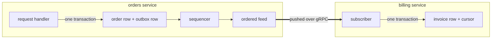

# z-event

z-event is a Rust library for reliable, push-based events between services, without a message broker.

A service writes its events into its own database, in the same transaction as the business change. Other services subscribe to that service's feed and receive each new event within milliseconds of the commit. Every consumer stores its position in the same transaction as the effect of the event, so crashes, restarts and network drops never lose an event and never apply one twice.

The current version is 0.1.0 and has not been released yet. All crates listed below are implemented and tested.

## How it works



The request handler in `orders` changes an order and appends an `OrderConfirmed` event in the same database transaction. If the transaction rolls back, the event never existed, and if it commits, the event will be delivered.

A sequencer gives every committed event the next position in the producer's feed. Positions have no gaps and follow commit order, which closes the classic outbox problem where a reader skips a row that committed late.

The `billing` subscriber holds one long-lived stream to `orders`. It receives the backlog first and then every new event as it is sequenced, and nobody polls. For each event it creates the invoice and moves its cursor in one transaction, and after a reconnect it skips anything at or below its cursor.

The rest is operations. Events that keep failing are parked per aggregate while other aggregates keep flowing, and they can be replayed after a fix. Old events are deleted only after every consumer has acknowledged them. A new consumer can start from the producer's current state instead of the whole history, and a producer restored from a backup is detected instead of silently diverging.

## Why no broker

At modest volume, up to hundreds of events per second per service, the database a service already runs is a perfectly good durable log. z-event gives broker-like guarantees without an extra clustered system to install, secure, back up and monitor. If a system outgrows it, a broker can be added as another transport adapter without touching the handlers, as [section 19 of the design](DESIGN.md#19-costs-limits-and-when-to-add-a-broker) explains.

## Crates

| Crate | Folder | What it is |
|---|---|---|
| `z-event` | `core/` | The protocol, `Producer`, `Subscriber`, the storage and transport traits, and an in-process transport, with no database or network dependencies |
| `z-event-postgres` | `adapters/postgres/` | PostgreSQL storage with the outbox, sequencer, notifications, cursors, parked events and embedded migrations |
| `z-event-grpc` | `adapters/grpc/` | gRPC transport with a feed service for an existing tonic server, a client for an existing channel, standalone helpers, and mutual TLS or bearer-token identity |
| `z-event-memory` | `adapters/memory/` | In-memory storage, the reference implementation for tests and examples |
| `z-event-cli` | `cli/` | Operations commands for feeds, consumers, parked events, cursors, epochs and migrations |
| `z-event-testkit` | `testkit/` | Conformance suites that every storage and transport adapter must pass |

## A first example

The producer appends an event in the transaction that confirms the order. The z-event tables live in a schema of their own, `orders_zevent`, inside the same database as the business schema `orders`, because both must commit in one transaction.

```rust
let store = z_event_postgres::migrate(&pool, "orders_zevent").await?;
let producer = Producer::new(store.clone(), ProducerConfig::new("orders"));
let _running = producer.start();

let mut tx = store.begin().await?;
sqlx::query("UPDATE orders.orders SET status = 'confirmed' WHERE id = $1")
    .bind("o17")
    .execute(&mut *tx)
    .await?;
producer
    .append(&mut tx, NewEvent::json("OrderConfirmed", "orders/o17", 2, &confirmed)?)
    .await?;
store.commit(tx).await?;
```

The consumer's handler runs inside the transaction that also moves its cursor.

```rust
struct CreateInvoice;

impl Handler<PgStore> for CreateInvoice {
    async fn handle(&self, tx: &mut sqlx::Transaction<'static, Postgres>, ev: &Event) -> Result<(), HandlerError> {
        let order: OrderConfirmed = ev.json().map_err(HandlerError::permanent)?;
        sqlx::query("INSERT INTO billing.invoices (order_id, amount_cents) VALUES ($1, $2)")
            .bind(order.order_id)
            .bind(order.amount_cents)
            .execute(&mut **tx)
            .await
            .map_err(HandlerError::transient)?;
        Ok(())
    }
}

let orders = z_event_grpc::Client::connect("http://orders:50051", None).await?.bearer_token(token)?;
let _billing = Subscriber::builder(billing_store, orders, CreateInvoice)
    .consumer("billing")
    .producer("orders")
    .types(["OrderConfirmed"])
    .spawn();
```

The guide walks through this setup step by step, and two runnable examples show it end to end. `examples/in-process` runs both services in one process on the in-memory adapter with `cargo run -p z-event-example-in-process`. `examples/split` runs `orders` and `billing` as two processes on PostgreSQL and gRPC, started with `DATABASE_URL=... cargo run -p z-event-example-split -- orders` in one terminal and the same command with `billing` in another.

## Guarantees

| Scope | Guarantee |
|---|---|
| Event and business change | Atomic, both exist or neither does |
| Delivery | At least once on the wire, and exactly once in effect for database effects |
| Order | Strict per aggregate, total per producer, none across producers |
| Outages | A consumer can be down for as long as the retention period without losing anything, and a producer restored from a backup is detected |

## Documentation

[DESIGN.md](DESIGN.md) explains the architecture, why it is built this way and how every part behaves under failure, with diagrams.

[docs/guide.md](docs/guide.md) shows how to use the library, from a single-process prototype to separate services on PostgreSQL and gRPC.

[docs/operating.md](docs/operating.md) covers deployment, settings, monitoring and runbooks.

[docs/writing-an-adapter.md](docs/writing-an-adapter.md) explains the storage and transport contracts and how to prove a new adapter with the conformance suites.

[IMPLEMENTATION_PLAN.md](IMPLEMENTATION_PLAN.md) records how the library was built and what comes next, and [CHANGELOG.md](CHANGELOG.md) lists the changes.

## Development

```sh
cargo test --workspace --all-features
cargo clippy --workspace --all-targets --all-features -- -D warnings
bash scripts/check-core-deps.sh
ZEVENT_TESTKIT_SCALE=10 cargo test --release -p z-event-memory --test conformance
```

The first command runs unit tests, documentation examples and the conformance suites on memory, PostgreSQL and gRPC. The third checks that the core depends on no database, gRPC library or adapter. The last one is a stress run with ten times the usual iterations.

The conformance suites are randomised, and every run prints its seed. Setting `ZEVENT_TESTKIT_SEED` to that value repeats the run exactly.

The PostgreSQL tests start `postgres:13-alpine` and `postgres:16-alpine` containers through testcontainers, so they need a running Docker daemon. Set `DOCKER_HOST` if its socket is not `/var/run/docker.sock`, for example with OrbStack or Colima. Set `ZEVENT_PG_URL` to run the tests against an existing server instead, where every store gets a fresh schema.

## Licence

z-event is licensed under either the [Apache License, Version 2.0](LICENSE-APACHE) or the [MIT licence](LICENSE-MIT), at your option.
