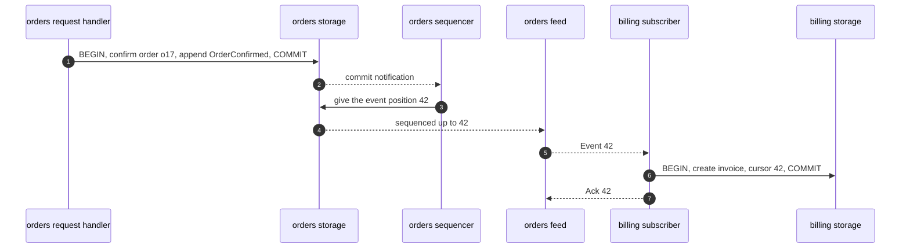
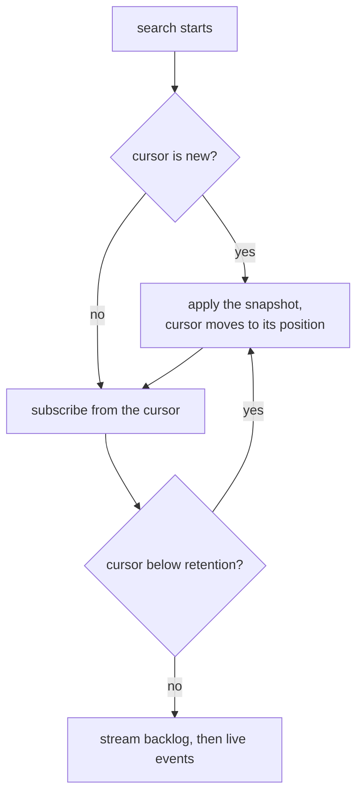
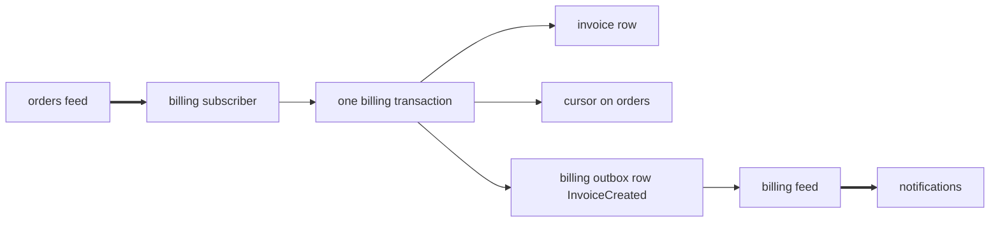
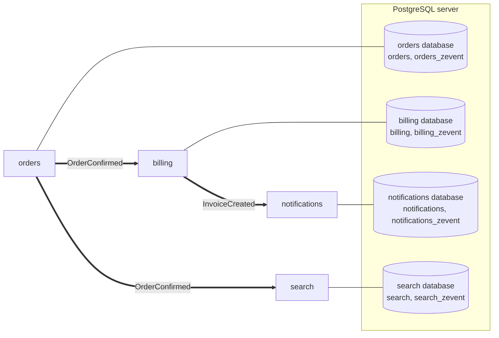

# Using z-event

This guide shows how to use z-event in an application. It starts with two services in one process and ends with separate services on PostgreSQL and gRPC. The reasoning behind each piece is in [DESIGN.md](../DESIGN.md), and running it in production is covered in [operating.md](operating.md).

The examples follow one domain. An `orders` service confirms orders and publishes `OrderConfirmed` events, and a `billing` service creates one invoice per confirmed order.

## 1. The moving parts

A producer is a service that publishes events. It appends them to its outbox inside its own transactions and serves them as a feed.

A consumer is a service that reacts to another service's events. It runs a subscriber per producer it follows, and the subscriber calls a handler for every event.

A feed is the producer's ordered list of events. Every event has a position, called `seq`, and positions have no gaps.

A cursor is a consumer's position in one producer's feed. It moves in the same transaction as the handler's effect.

An aggregate is the record an event is about, such as `orders/o17`. Events for one aggregate are delivered in order, and a failing aggregate is parked without blocking the others.



## 2. Two services in one process

The fastest way to see z-event work is to run both services in one process on the in-memory store. Nothing here needs a database or a network.

```rust
use serde::{Deserialize, Serialize};
use z_event::{AllowAll, Event, Handler, HandlerError, InProcess, NewEvent, Producer, ProducerConfig, Store, Subscriber};
use z_event_memory::{MemoryStore, MemoryTx};

#[derive(Serialize, Deserialize)]
struct OrderConfirmed {
    order_id: String,
    amount_cents: u64,
}

struct CreateInvoice;

impl Handler<MemoryStore> for CreateInvoice {
    async fn handle(&self, tx: &mut MemoryTx, ev: &Event) -> Result<(), HandlerError> {
        let order: OrderConfirmed = ev.json().map_err(HandlerError::permanent)?;
        tx.put(format!("invoices/{}", order.order_id), order.amount_cents.to_string());
        Ok(())
    }
}

#[tokio::main]
async fn main() -> Result<(), z_event::BoxError> {
    let orders_db = MemoryStore::new();
    let billing_db = MemoryStore::new();

    let producer = Producer::new(orders_db.clone(), ProducerConfig::new("orders"));
    let running = producer.start();
    let transport = InProcess::new();
    transport.register("orders", producer.feed_source(AllowAll));

    let billing = Subscriber::builder(billing_db.clone(), transport, CreateInvoice)
        .consumer("billing")
        .producer("orders")
        .types(["OrderConfirmed"])
        .spawn();

    let mut tx = orders_db.begin().await?;
    tx.put("orders/o1", "confirmed");
    let event = NewEvent::json("OrderConfirmed", "orders/o1", 1, &OrderConfirmed { order_id: "o1".into(), amount_cents: 1000 })?;
    producer.append(&mut tx, event).await?;
    orders_db.commit(tx).await?;

    tokio::time::sleep(std::time::Duration::from_millis(100)).await;
    assert!(billing_db.get("invoices/o1").is_some());

    billing.shutdown().await?;
    running.shutdown().await;
    Ok(())
}
```

`MemoryStore` stands for one service's database, and `MemoryTx` is its transaction. The order and the event commit together in `orders_db`, and the invoice and the cursor commit together in `billing_db`. The same code runs unchanged on PostgreSQL and gRPC later, because only the store and the transport change. The complete program is in `examples/in-process`.

## 3. Defining events

z-event does not define event types. A host usually keeps its event structs in a shared crate and serialises them as JSON into the payload.

```rust
let event = NewEvent::json("OrderConfirmed", format!("orders/{id}"), order_version, &OrderConfirmed { order_id: id.clone(), amount_cents })?
    .correlation(request_id)
    .header("tenant", tenant)
    .header("actor", user_id)
    .version(2);
```

The type, here `OrderConfirmed`, is what consumers filter on and what access control checks. The aggregate names the record the event is about, and all events of one aggregate are delivered in order. The aggregate version is the record's version after the change, and handlers use it to ignore events they have already seen. The correlation id is the id of the user's request and connects the event to that request in traces. Headers carry metadata that z-event never reads, such as the tenant. The schema version lets a consumer accept the current and the previous payload format while a change rolls out.

Every event also gets a ULID as its id when it is created. That id is the idempotency key for anything the consumer does outside its own database.

## 4. The producer on PostgreSQL

A producing service creates its z-event tables at startup and starts the producer once per process. The tables go into a schema of their own, `orders_zevent`, in the same database as the service's business schema `orders`.

```rust
use sqlx::postgres::PgPoolOptions;
use z_event::{Producer, ProducerConfig};

let app_pool = PgPoolOptions::new().max_connections(20).connect(&database_url).await?;
let zevent_pool = PgPoolOptions::new().max_connections(5).connect(&database_url).await?;
let store = z_event_postgres::migrate(&zevent_pool, "orders_zevent").await?;
let producer = Producer::new(store.clone(), ProducerConfig::new("orders"));
let running = producer.start();
```

Both schemas have to be in one database, because the event commits in the business transaction. The separate schema keeps z-event's fixed table names such as `outbox` away from the service's own tables and out of the way of its migration tools. The two pools point at the same database. Requests use `app_pool`, and `zevent_pool` serves only z-event's background work, the sequencer, feed reads, acknowledgements and retention, so that work never takes connections the requests need. One pool for both works too.

`migrate` creates or upgrades the tables in the `orders_zevent` schema and is safe to run from every replica at the same time. `start` launches the sequencer, the notification listener and the retention job. Every replica calls it, and the replicas agree among themselves which one stamps events.

Appending is part of the business transaction. The transaction type is sqlx's own, so the service begins it on its own pool, runs its SQL on it and passes it to `append`.

```rust
async fn confirm(app_pool: &PgPool, producer: &Producer<PgStore>, id: &str, request_id: &str) -> Result<(), BoxError> {
    let mut tx = app_pool.begin().await?;
    let row: (i64, i64) = sqlx::query_as("UPDATE orders.orders SET status = 'confirmed', version = version + 1 WHERE id = $1 RETURNING version, amount_cents")
        .bind(id)
        .fetch_one(&mut *tx)
        .await?;
    let (version, amount_cents) = row;
    let event = NewEvent::json("OrderConfirmed", format!("orders/{id}"), version as u64, &OrderConfirmed { order_id: id.into(), amount_cents })?
        .correlation(request_id);
    producer.append(&mut tx, event).await?;
    tx.commit().await?;
    Ok(())
}
```

The `UPDATE` takes a row lock on the order, so two confirmations of the same order are serialised and their events reach the feed in the same order. If anything fails before the commit, the order is unchanged and the event never existed.

The defaults suit most services. `ProducerConfig` changes them when needed.

```rust
let config = ProducerConfig::new("orders")
    .retention(Duration::from_secs(30 * 24 * 3600))
    .safety_interval(Duration::from_millis(500));
```

## 5. Serving the feed over gRPC

Consumers in other processes reach the feed through the gRPC adapter. A service that already runs a tonic server adds the feed as one more service and keeps its own port, TLS and interceptors.

```rust
use tonic::transport::Server;
use z_event::TypeAcl;
use z_event_grpc::{TokenIdentity, feed_service};

let acl = TypeAcl::new()
    .allow("billing", ["OrderConfirmed", "OrderCancelled"])
    .allow("audit", ["*"]);
let identity = TokenIdentity::new()
    .token(billing_token, "billing")
    .token(audit_token, "audit");

Server::builder()
    .add_service(my_orders_api)
    .add_service(feed_service(producer.feed_source(acl), identity))
    .serve(addr)
    .await?;
```

The access control list says which consumer may read which event types. A consumer that asks for a type it may not read is refused, and a consumer that asks for no particular types receives only what it may read.

The identity decides who is calling. With `TokenIdentity` a consumer sends a bearer token and the server maps it to a consumer name. With `MtlsIdentity` the consumer's client certificate is its identity, and the server must require client certificates.

```rust
use tonic::transport::{Certificate, Identity, ServerTlsConfig};
use z_event_grpc::{MtlsIdentity, serve_standalone};

let tls = ServerTlsConfig::new()
    .identity(Identity::from_pem(server_cert, server_key))
    .client_ca_root(Certificate::from_pem(ca_cert));
serve_standalone(producer.feed_source(acl), MtlsIdentity::default(), addr, Some(tls)).await?;
```

`serve_standalone` is for services without a gRPC server of their own. `serve_standalone_with_shutdown` does the same on a listener the caller has already bound and stops when a future completes.

## 6. The consumer

A consumer implements `Handler` for its store and gives it to a subscriber. The handler receives the consumer's transaction and the event, and everything it writes through that transaction commits together with the cursor.

```rust
struct CreateInvoice;

impl Handler<PgStore> for CreateInvoice {
    async fn handle(&self, tx: &mut sqlx::Transaction<'static, Postgres>, ev: &Event) -> Result<(), HandlerError> {
        let order: OrderConfirmed = ev.json().map_err(HandlerError::permanent)?;
        sqlx::query(
            "INSERT INTO billing.invoices (order_id, amount_cents, order_version) VALUES ($1, $2, $3)
             ON CONFLICT (order_id) DO UPDATE SET amount_cents = $2, order_version = $3
             WHERE billing.invoices.order_version < $3",
        )
        .bind(&order.order_id)
        .bind(order.amount_cents as i64)
        .bind(ev.aggregate_version as i64)
        .execute(&mut **tx)
        .await
        .map_err(HandlerError::transient)?;
        Ok(())
    }
}
```

The error kind tells the subscriber what to do. A transient error, such as a timeout or a lock conflict, is retried with backoff. A permanent error, such as a payload that cannot be parsed, is parked right away, because retrying it would never help.

The `WHERE ... order_version < $3` clause makes the handler safe for replays. If the same event or an older one arrives again, for example after an operator rewinds the cursor, the row is left as it is.

The subscriber connects to the producer, reads the backlog, follows live events and reconnects on its own.

```rust
use z_event::{Backoff, RetryPolicy, Subscriber};
use z_event_grpc::Client;

let billing_db = z_event_postgres::migrate(&zevent_pool, "billing_zevent").await?;
let orders = Client::connect("http://orders:50051", None).await?.bearer_token(&billing_token)?;
let subscriber = Subscriber::builder(billing_db, orders, CreateInvoice)
    .consumer("billing")
    .producer("orders")
    .types(["OrderConfirmed"])
    .retry(RetryPolicy { max_attempts: 5, ..RetryPolicy::default() })
    .reconnect(Backoff::new(Duration::from_millis(100), Duration::from_secs(30)))
    .build();
let handle = subscriber.spawn();
```

The subscriber begins its transactions on the store's pool, so the handler's writes to `billing.invoices` go through `zevent_pool` as well. That pool carries the apply work on the consumer side and should be sized for the event rate.

`build` returns a `Subscriber`, which the service can keep for administration such as replays, and `spawn` starts it and returns a handle. The handle reports the status and stops the subscriber cleanly.

```rust
match handle.status() {
    SubscriberStatus::Streaming { cursor, head } => tracing::info!(%cursor, %head, "billing is streaming"),
    SubscriberStatus::Stopped(reason) => tracing::error!(?reason, "billing stopped"),
    _ => {}
}
handle.shutdown().await?;
```

A subscriber stops by itself only when continuing would be wrong. That happens when the producer refuses the consumer's identity, when the producer's feed was reset after a restore, or when the consumer fell below the retention window without a snapshot to recover from. Network errors and storage errors are retried.

A handler that must call another system, such as a mail server, writes a job row in its transaction instead of calling out. A separate worker sends the mail and uses the event id as idempotency key, so a retried job never sends the same mail twice.

```rust
sqlx::query("INSERT INTO notifications.jobs (id, kind, payload) VALUES ($1, 'order-confirmed-mail', $2) ON CONFLICT DO NOTHING")
    .bind(ev.id.to_string())
    .bind(ev.payload.as_ref())
    .execute(&mut **tx)
    .await
    .map_err(HandlerError::transient)?;
```

## 7. When a handler keeps failing

Suppose a deploy introduced a bug that fails for orders with a discount. The subscriber retries each failing event and then parks it, together with every later event of the same order, while all other orders keep flowing. The `feed_dead_letters` metric rises above zero and the alert fires.

An operator lists the parked events from the consumer's z-event schema.

```text
$ z-event-cli --schema billing_zevent parked list --consumer billing --producer orders
1882    orders/o902    OrderConfirmed    attempts 5    open    transient: discount column missing
1890    orders/o902    OrderUpdated      attempts 0    open    parked behind an earlier event of orders/o902
```

After the fix is deployed, the parked events are replayed by the service itself, because replay runs the service's handlers. A small admin endpoint is enough.

```rust
async fn replay_parked(subscriber: &Subscriber<PgStore, Client, CreateInvoice>, aggregate: Option<String>) -> Result<ReplayReport, SubscriberError> {
    let mut filter = ParkedFilter::unresolved();
    filter.aggregate = aggregate;
    subscriber.replay_parked(filter).await
}
```

A service can also offer the same commands as the CLI from its own binary, including replay, by passing its subscriber to `z_event_cli::execute`.

```rust
let cli = z_event_cli::Cli::parse();
z_event_cli::execute(&billing_db, cli.command, &mut std::io::stdout(), Some(&subscriber)).await?;
```

Replay applies the parked events in order. An event that fails again stays parked, and the rest of its order stays behind it. An event that should never be applied is dropped with `parked resolve --seq N`.

## 8. New consumers and snapshots

A new consumer subscribes from position zero and receives the whole retained history, which is often what it needs. When history is long, or older than the retention period, the consumer can start from the producer's current state instead.

The producer describes its current state with a `Snapshotter`. It reads through a consistent read-only transaction and returns one snapshot event per record.

```rust
struct OrderSnapshots;

impl Snapshotter<PgStore> for OrderSnapshots {
    async fn snapshot(&self, tx: &mut sqlx::Transaction<'static, Postgres>, request: &SnapshotRequest) -> Result<Vec<NewEvent>, BoxError> {
        if !request.aggregate_types.iter().any(|t| t == "orders") {
            return Ok(Vec::new());
        }
        let rows: Vec<(String, i64, i64)> = sqlx::query_as("SELECT id, version, amount_cents FROM orders.orders WHERE status = 'confirmed'")
            .fetch_all(&mut **tx)
            .await?;
        rows.into_iter()
            .map(|(id, version, amount_cents)| {
                Ok(NewEvent::json("OrderSnapshot", format!("orders/{id}"), version as u64, &OrderConfirmed { order_id: id, amount_cents: amount_cents as u64 })?)
            })
            .collect()
    }
}

let source = producer.feed_source(acl).with_snapshotter(OrderSnapshots);
```

The consumer opts in with `bootstrap_from_snapshot` and handles the snapshot event type like any other.

```rust
let subscriber = Subscriber::builder(search_db, orders, IndexOrders)
    .consumer("search")
    .producer("orders")
    .bootstrap_from_snapshot(["orders"])
    .spawn();
```



The bootstrap also rescues a consumer that was down so long that the producer has already deleted the events after its cursor. Without the option, such a consumer stops and alerts instead of skipping events.

## 9. A service that consumes and produces

Services often do both. `billing` reacts to `OrderConfirmed` and publishes `InvoiceCreated` for other services. Because one store serves both roles, the invoice, the cursor and the new event commit in one transaction.

```rust
struct CreateInvoice {
    billing: Producer<PgStore>,
}

impl Handler<PgStore> for CreateInvoice {
    async fn handle(&self, tx: &mut sqlx::Transaction<'static, Postgres>, ev: &Event) -> Result<(), HandlerError> {
        let order: OrderConfirmed = ev.json().map_err(HandlerError::permanent)?;
        let invoice_id = ulid::Ulid::new().to_string();
        sqlx::query("INSERT INTO billing.invoices (id, order_id, amount_cents) VALUES ($1, $2, $3)")
            .bind(&invoice_id)
            .bind(&order.order_id)
            .bind(order.amount_cents as i64)
            .execute(&mut **tx)
            .await
            .map_err(HandlerError::transient)?;
        let mut created = NewEvent::json("InvoiceCreated", format!("invoices/{invoice_id}"), 1, &invoice_id)
            .map_err(HandlerError::permanent)?;
        if let Some(correlation) = &ev.correlation_id {
            created = created.correlation(correlation.clone());
        }
        self.billing.append(tx, created).await.map_err(HandlerError::transient)?;
        Ok(())
    }
}
```



The correlation id is passed on, so a trace still connects the original user request with the email that `notifications` eventually sends.

## 10. Testing services

Handlers and wiring can be tested without a database. `MemoryStore` behaves like a real store, with transactions, locks and commit-order visibility, and `InProcess` replaces the network. The quick start in section 2 is already a complete integration test of two services.

```rust
#[tokio::test(flavor = "multi_thread")]
async fn confirmed_orders_are_invoiced_once() {
    let (orders_db, billing_db) = (MemoryStore::new(), MemoryStore::new());
    let producer = Producer::new(orders_db.clone(), ProducerConfig::new("orders"));
    let running = producer.start();
    let transport = InProcess::new();
    transport.register("orders", producer.feed_source(AllowAll));
    let billing = Subscriber::builder(billing_db.clone(), transport, CreateInvoice)
        .consumer("billing")
        .producer("orders")
        .spawn();

    confirm_in_memory(&producer, "o1").await;
    confirm_in_memory(&producer, "o2").await;

    wait_until(|| billing_db.scan_prefix("invoices/").len() == 2).await;
    billing.shutdown().await.unwrap();
    running.shutdown().await;
}
```

`confirm_in_memory` appends an event the way section 2 does, and `wait_until` polls a condition with a timeout. Both are a few lines and are left out here.

For tests against PostgreSQL, the repository's own tests show the pattern. They start a container with testcontainers, give every store a fresh schema and run the same scenarios.

## 11. The whole picture

A typical deployment has several services, each with its own database, its own feed and its own subscribers. In every database the business tables and the z-event tables have a schema each.



Every arrow is one gRPC stream opened by the consumer. No service knows who consumes its feed, so adding a consumer never changes the producer.

`examples/split` runs the first arrow for real, with `orders` and `billing` as separate processes, each with its own database on one PostgreSQL server. Its test starts a container, launches both binaries and checks that every order produced exactly one invoice.
