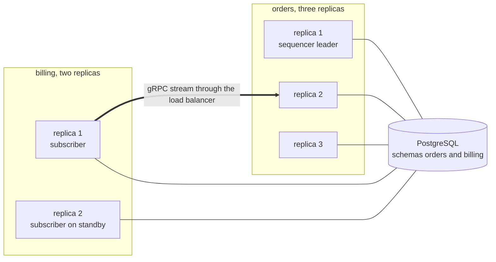
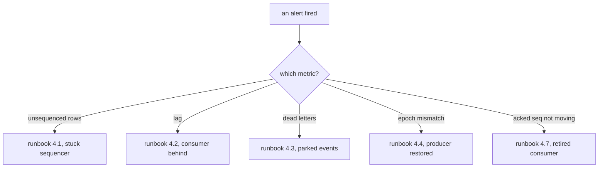
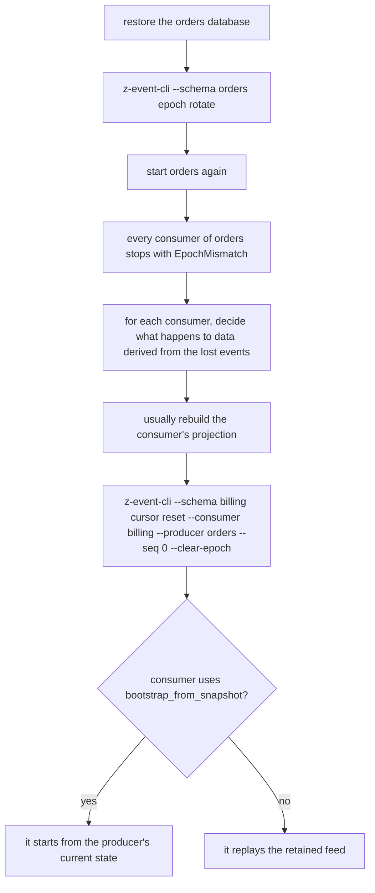

# Operating z-event

This guide is for the people who deploy and run services that use z-event. It covers how to deploy, which settings matter, what to watch and what to do when something goes wrong. The design behind it is in [DESIGN.md](../DESIGN.md) and the API is described in [guide.md](guide.md).

## 1. Deployment

Each service keeps the z-event tables in its own PostgreSQL schema, next to its business tables. Services may share a database server and a connection pool, and z-event never reads another service's schema.

Every replica runs the migrations at startup. They create or upgrade the tables in the service's schema, record what they did in `zevent_migrations`, and are safe to run from several replicas at the same moment.

```rust
let store = z_event_postgres::migrate(&pool, "orders").await?;
```

Every replica of a producing service starts the producer. Only one replica at a time stamps events, the sequencer leader, which holds a PostgreSQL advisory lock. The others try to take over every second and do so as soon as the leader's database connection goes away. Every replica can serve the feed to consumers.

A consumer runs one subscriber per producer it follows. Running the same subscriber on several replicas is safe, because the cursor lock and the duplicate check prevent double effects, but only one replica makes progress at a time, so it adds nothing but standby capacity.



The feed is served over gRPC, either on the service's existing tonic server or with `serve_standalone`. Every consumer needs an identity, a client certificate with `MtlsIdentity` or a bearer token with `TokenIdentity`. Every feed needs an access control list, a `TypeAcl` or a custom `Acl`, and `AllowAll` belongs in development only.

## 2. Settings that matter

| Setting | Default | What it controls |
|---|---|---|
| `ProducerConfig::retention` | 90 days | How long acknowledged events are kept for replays. A shorter period saves storage, and consumers that fall further behind must bootstrap from a snapshot |
| `ProducerConfig::safety_interval` | 1 second | The longest delay between commit and feed when a notification is lost |
| `ProducerConfig::retention_interval` | 5 minutes | How often old events are purged and the producer's gauges refreshed |
| `FeedConfig::heartbeat` | 15 seconds | How often idle streams send a checkpoint, which also bounds how quickly a rotated epoch stops open streams |
| `FeedConfig::backlog_batch` | 500 | How many events a stream reads from storage at a time while catching up |
| `SubscriberBuilder::retry` | 5 attempts, 0.1 to 30 seconds | How long a failing event is retried before it is parked |
| `SubscriberBuilder::reconnect` | 0.1 to 30 seconds with jitter | How quickly a subscriber reconnects after losing its stream |
| `SubscriberBuilder::batch_size` | 1 | How many already buffered events share one transaction, useful for projections |
| `SubscriberBuilder::ack_interval` | 5 seconds | How often the consumer reports its position to the producer |
| `SubscriberBuilder::bootstrap_from_snapshot` | off | Whether a new or far behind consumer starts from the producer's snapshot, which needs a `Snapshotter` on the producer |

## 3. Monitoring

z-event reports through the `metrics` facade and through `tracing`. Install the metrics exporter the platform uses, for example Prometheus, and the metrics appear under the names in `z_event::telemetry`.

| Metric | Alert when | What it means |
|---|---|---|
| `feed_unsequenced_rows{producer}` | above zero for more than 10 seconds | committed events are not being stamped, so the sequencer is stuck |
| `feed_sequencer_leader{producer}` | no replica reports 1 for more than 10 seconds | no replica holds the sequencer lease |
| `feed_consumer_lag_seconds{producer,consumer}` | above 60 seconds for 5 minutes | a consumer is behind |
| `feed_dead_letters{producer,consumer}` | above zero | events are parked and need attention |
| `feed_epoch_mismatch_total` and `feed_epoch_rotations_total` | any increase | a producer's feed was reset, usually by a restore from backup |
| `feed_stream_reconnects_total` | a sustained high rate | network trouble or a crashing producer |
| `feed_consumer_acked_seq{producer,consumer}` | not moving for a day | a consumer is gone and holds back retention |

Every applied event runs in a `z_event.apply` span that carries the correlation id of the user's request, so one trace shows the request and every effect it caused across services.

The `z-event-cli` binary gives a quick look at any schema. It needs the database URL, through `--database-url` or `DATABASE_URL`, and the schema, through `--schema` or `ZEVENT_SCHEMA`.

```text
z-event-cli --schema orders head
z-event-cli --schema orders consumers list
z-event-cli --schema billing cursor show --consumer billing --producer orders
z-event-cli --schema billing parked list --consumer billing --producer orders
```

Producer-side commands such as `head`, `consumers` and `epoch` act on the producer's schema. Consumer-side commands such as `cursor` and `parked` act on the consumer's schema.



## 4. Runbooks

### 4.1 The sequencer is stuck

The `feed_unsequenced_rows` gauge stays above zero, so events are committed but nobody gives them positions.

First check `feed_sequencer_leader`. If no replica leads, the replicas cannot take the advisory lock. Look for a connection that still holds it with `SELECT * FROM pg_locks WHERE locktype = 'advisory'`, and for database errors in the logs under the message `sequencer could not try the lease`.

If a replica leads but nothing is stamped, look for `sequencing failed; giving the lease up` in its logs. The replica steps down on its own and another one takes over.

Restarting the producing service is always safe. Committed events are never lost, and the next leader stamps them.

### 4.2 A consumer is behind

Compare the consumer's cursor with the producer's head to see how far behind it is.

```text
z-event-cli --schema billing cursor show --consumer billing --producer orders
z-event-cli --schema orders head
```

A slow handler is the usual cause. For projections that apply many small events, raise `batch_size`. For handlers that start slow external work, let the handler write a job row and scale the workers instead.

Lag never slows the producer down. It keeps appending, and the consumer catches up at full speed once the cause is fixed.

### 4.3 Events are parked

The `feed_dead_letters` gauge is above zero. List the parked events in the consumer's schema.

```text
z-event-cli --schema billing parked list --consumer billing --producer orders
```

The first failed event of an aggregate shows how many attempts were made and the last error. Later events of the same aggregate show zero attempts, because they were parked behind it without running the handler. That preserves the aggregate's order while other aggregates keep flowing.

Fix the cause, which is usually a bug, bad data or a missing dependency, and deploy.

Then replay. Replay runs the service's own handlers, so it runs inside the service, either through an admin endpoint that calls `Subscriber::replay_parked` or through the CLI commands mounted in the service's binary with `z_event_cli::execute`. Events that fail again stay parked, and the rest of their aggregate stays behind them. The generic `z-event-cli` binary refuses `parked replay` and says so.

To drop an event on purpose, mark it resolved without running its handler. Do this only when the effect is known to be unwanted.

```text
z-event-cli --schema billing parked resolve --consumer billing --producer orders --seq 1882
```

### 4.4 Restoring a producer from a backup

A restored producer's feed goes back in time. The events after the backup point are gone and new events will reuse their positions, so consumers must not continue as if nothing happened.



Rotate the epoch before starting the restored service. If that step is forgotten, z-event rotates the epoch by itself as soon as a consumer turns out to be ahead of the head, but a consumer that happens not to be ahead would continue on reused positions until then.

### 4.5 Restoring a consumer from a backup

Nothing special is needed. The consumer's cursor lives in the same database as its data, so both are restored together. It subscribes again from the restored cursor and the producer sends everything since.

If the restored position is older than the producer's retention window, the subscriber stops with `BeyondRetention`. With `bootstrap_from_snapshot` it bootstraps from the producer's snapshot instead.

### 4.6 A new consumer joins a producer with a long history

Either let it replay, which means it subscribes from position zero and catches up at full speed within the retention period, or configure `bootstrap_from_snapshot` so it starts from the producer's current state. The second option needs a `Snapshotter` on the producer's feed source.

### 4.7 A consumer is retired

Registered consumers hold back retention until they acknowledge. Remove a retired consumer so the producer can purge its old events.

```text
z-event-cli --schema orders consumers remove search
```

### 4.8 Replaying a consumer from a position

Reset its cursor, before it starts or while it runs. A running subscriber notices and subscribes again from the new position.

```text
z-event-cli --schema search cursor reset --consumer search --producer orders --seq 1200
```

Handlers that check `aggregate_version` make this safe over data they have already applied.

## 5. Security checklist

Every feed has an access control list, and event types that carry personal data are readable only by the consumers that need them.

Every consumer authenticates with a client certificate or a token. The consumer name in a subscription must match the caller's identity, so one service cannot read a feed under another service's name.

Producers keep personal data out of events unless the consumer is allowed to see it, because z-event never looks at payloads or headers.

Each service's database user needs rights only in its own schema.
