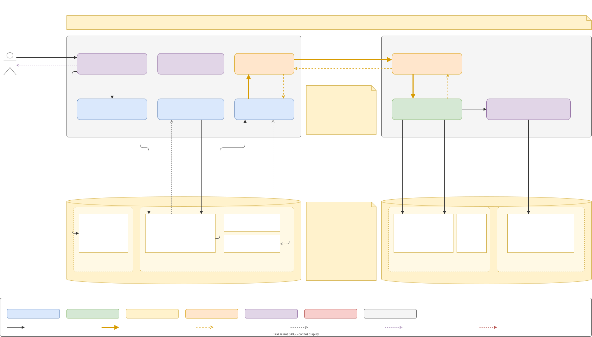
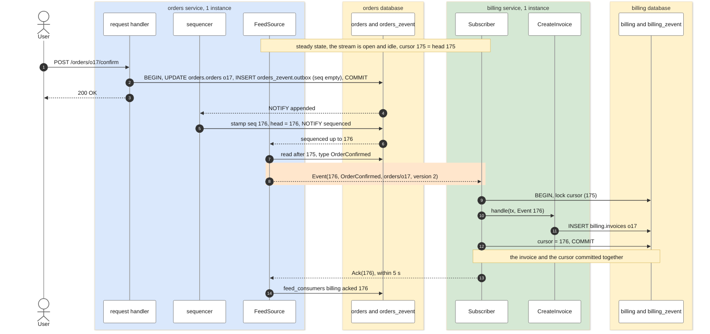
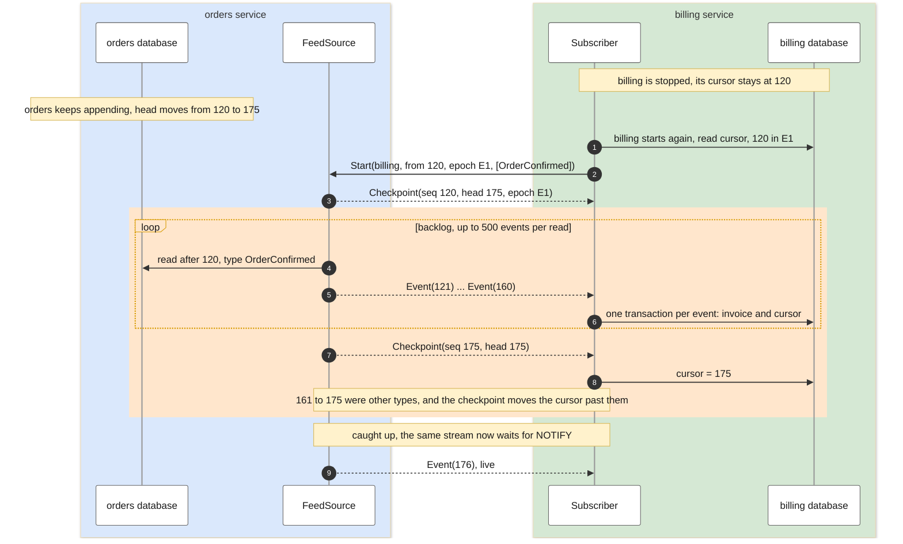
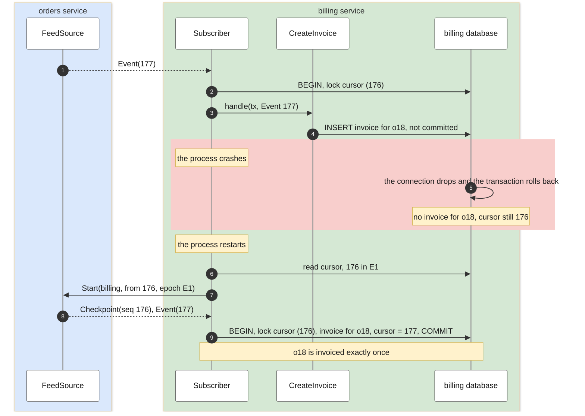
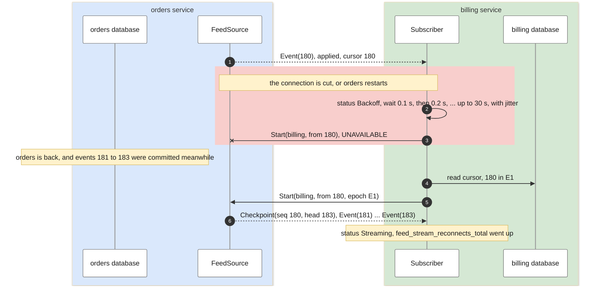
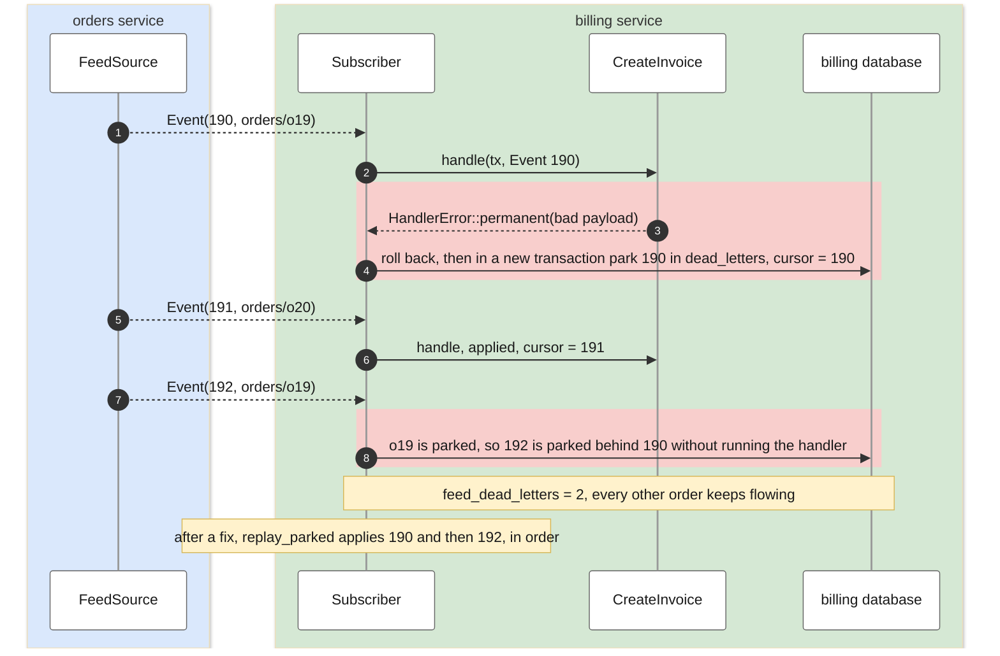

# z-event scenarios

This document shows how z-event behaves in the topologies that real systems use. It runs from one producer instance and one consumer instance, through replicated producers and consumers, up to many services that produce and consume each other's events. Each scenario has a component diagram, a sequence diagram of the successful path, sequence diagrams of the sub-scenarios that branch off it, and a worked example with concrete positions and code.

The reasoning behind the mechanics is in [DESIGN.md](../DESIGN.md), the API is explained in [guide.md](guide.md), and running it in production is covered in [operating.md](operating.md).

The examples use the same domain as the rest of the documentation. `orders` confirms orders and publishes `OrderConfirmed`, `billing` creates invoices, `notifications` sends emails, and `search` keeps an index.

Two words are used carefully throughout. An instance is one running replica of a service, so three instances of `billing` share the name `billing`, the same schema and the same cursor. A different service has its own name, its own schema and its own cursor, as `billing` and `search` do.

| Scenario | Producers | Consumers |
|---|---|---|
| [0. Baseline](#0-baseline-one-producer-instance-one-consumer-instance) | one instance of `orders` | one instance of `billing` |
| 1. Consumer replicas | one instance of `orders` | several instances of `billing` |
| 2. Producer replicas | several instances of `orders` | one instance of `billing` |
| 3. Fan-out | `orders` | `billing`, `notifications` and `search` |
| 4. Fan-in | `orders` and `billing` | `search` |
| 5. Many to many | every service | every service |

## Legend

The component diagrams are drawn in draw.io. Every image is an editable `.drawio.svg` that opens directly in draw.io, and its plain XML source is the `.drawio` file next to it in [docs/diagrams](diagrams). After editing a source file, `scripts/export-diagrams.sh` regenerates the images.

The sequence diagrams use the same colours.

| Colour | Fill | Border | Meaning |
|---|---|---|---|
| Blue | `#DAE8FC` | `#6C8EBF` | Producer side, which covers `Producer`, the sequencer and `FeedSource`, and the producer's box in sequence diagrams |
| Green | `#D5E8D4` | `#82B366` | Consumer side, which covers `Subscriber` and its cursor, and the consumer's box in sequence diagrams |
| Yellow | `#FFF2CC` | `#D6B656` | Storage, meaning schemas and tables, and notes in sequence diagrams |
| Orange | `#FFE6CC` | `#D79B00` | Transport and streams, and stream phases in sequence diagrams |
| Purple | `#E1D5E7` | `#9673A6` | Host code, meaning request handlers, `Handler`, `Acl` and `Snapshotter` |
| Red | `#F8CECC` | `#B85450` | Failures, parked events and refusals |
| Grey | `#F5F5F5` | `#666666` | Service boundaries |

Lines have three meanings. A thin black arrow is a call or a write inside a transaction. A bold orange arrow carries events pushed down a stream. A dashed arrow is a notification, an acknowledgement or a `Start` message, and it is orange when it travels over the transport.

## 0. Baseline, one producer instance, one consumer instance

One instance of `orders` publishes `OrderConfirmed`, and one instance of `billing` turns each confirmed order into an invoice. Every other scenario builds on this one and only shows what changes, so this section walks through every step.

The diagram shows the most common case, real-time delivery. `billing` has applied everything, so nothing is outstanding. Its stream has been open since it started, and a user confirms an order.



Source: [00-baseline.drawio](diagrams/00-baseline.drawio)

The data enters at the top left. A user or another system calls the `orders` API, and everything after that follows from the one transaction the request handler commits.

| Step | Where | What happens |
|---|---|---|
| before | billing → orders | When `billing` started, its subscriber read its cursor and opened one gRPC `Subscribe` call with `Start(billing, from 175, epoch E1, [OrderConfirmed])`. `orders` checked the caller's identity, the `Acl`, the epoch and the retention window once, then answered `Checkpoint(seq 175, head 175, epoch E1)`. Since then the stream has stayed open and idle, with a heartbeat checkpoint every 15 seconds. |
| ① | user → orders | `POST /orders/o17/confirm` reaches the request handler, which is host code. |
| ② | orders database | The handler begins a transaction, updates order `o17` in schema `orders`, calls `producer.append(&mut tx, event)`, which inserts an outbox row with an empty `seq` into schema `orders_zevent`, and commits. Both rows commit together or not at all. |
| ③ | orders → user | The handler answers `200 OK`. The user waits for nothing downstream. |
| ④ | orders database → sequencer | PostgreSQL delivers `NOTIFY zevent_orders_zevent_appended` at commit, never earlier, so the sequencer only ever sees committed rows. |
| ⑤ | sequencer → orders database | The sequencer, which holds the lease, stamps the row with `seq = head + 1 = 176`, moves `feed_meta.head` to 176 and sends a `sequenced` notification. |
| ⑥ | orders database → FeedSource | `billing`'s open stream wakes up on the notification and reads the committed events after 175 that match its types, which is event 176. |
| ⑦ | orders → billing | `Event(176)` is pushed down the existing stream to the subscriber. The note on the diagram shows the envelope it carries. |
| ⑧ | billing database | The subscriber begins a transaction and locks its cursor row. The cursor is 175 and the event is 176, so it is new, and the subscriber calls `CreateInvoice::handle(&mut tx, event)`. |
| ⑨ | billing database | The handler inserts the invoice into schema `billing` through the same transaction. The subscriber moves the cursor in schema `billing_zevent` to 176 and commits. The invoice and the cursor commit together. |
| ⑩ | billing → orders | Within five seconds the subscriber sends `Ack(176)` on the same call. `FeedSource` records it in `feed_consumers`, where it drives the lag metrics and retention. Delivery never waits for it. |

From ③ to ⑨ typically takes a few milliseconds. Steps ④ to ⑥ are driven by database notifications, and step ⑦ uses a stream that is already open, so nothing in the path polls or waits on a timer.

### Databases

Each service has one database, so this scenario uses two, the `orders` database and the `billing` database. z-event does not get a database of its own. Its tables live in the service's database, in a separate schema.

This is required for correctness. On the producer side, the outbox row must commit in the same transaction as the business change, which is what makes a rolled-back change leave no event behind. On the consumer side, the cursor must commit in the same transaction as the handler's effect, which is what makes an event apply exactly once. A transaction cannot span two databases. With z-event in a separate database, every write would become a dual write, which is the problem z-event exists to solve, as [DESIGN.md section 1](../DESIGN.md#1-the-problem) explains.

The load can still be kept apart within the one database.

| Lever | How | What it separates |
|---|---|---|
| Separate schema | `migrate(&pool, "orders_zevent")`, with business tables in schema `orders` | Names, permissions and statistics. The fixed z-event names such as `outbox` cannot collide with the service's tables, migration tools that diff a schema never see them, and an operations role can be given the z-event schema alone |
| Separate connection pool | Business requests use the host's pool. The store gets a small pool of its own | The sequencer, the feed reads, acks and retention can never take connections from the request path. The sequencer lease and the notification listener each hold one extra dedicated connection |

A schema only separates names. Both schemas share the database's memory, disk, write-ahead log and vacuum workers, so the schema keeps things tidy and the pool keeps the load apart. For the same reason the two schemas are one unit for backups. Back up and restore the whole service database, never one schema alone, as [operating.md runbook 4.4](operating.md#44-restoring-a-producer-from-a-backup) explains.

What z-event adds to the load is small and predictable.

| Database | Per event | Periodically |
|---|---|---|
| Producer | One outbox `INSERT` inside a transaction the service already runs, a share of one batched `UPDATE` by the sequencer, and a share of one indexed range read per open stream | One ack upsert per consumer every 5 s, and one retention `DELETE` every 5 min on the sequencer leader |
| Consumer | A `SELECT ... FOR UPDATE` and an `UPDATE` of one cursor row, inside the handler's transaction | Nothing |

At the volumes z-event is built for, up to hundreds of events per second per service, this is a small fraction of what the business transactions themselves cost. A service that outgrows that should add a broker as a transport, as [DESIGN.md section 19](../DESIGN.md#19-costs-limits-and-when-to-add-a-broker) describes, and should not move the outbox out of its database.

### 0.1 Successful path, real-time delivery



The user's request returns as soon as the order commits, and everything after that happens asynchronously. The sequence diagram numbers each message, so its numbers are finer grained than the steps ① to ⑩ of the component diagram.

### 0.2 billing was down, so it catches up and then follows live

`billing` was stopped for a deployment while `orders` confirmed 56 more orders. Nothing is lost, because the events wait in the outbox, and `billing` resumes from its cursor.



`billing` receives the backlog at full speed on the same stream that then carries live events. There is no separate catch-up mode and no polling. The outage can last as long as the retention period, 90 days by default, because retention never deletes an event that `billing` has not acknowledged.

### 0.3 billing crashes while applying an event

The `billing` process is killed after the handler wrote the invoice but before the commit.



The effect and the cursor live in one transaction, so a crash at any point leaves both of them in the old state or both in the new one. The producer resends from the stored cursor, and the event is applied once.

### 0.4 The stream drops, or orders restarts



Network errors and unavailable producers are always retried. The subscriber only stops when continuing would be wrong, which means a refused identity, an epoch mismatch after the producer was restored from a backup, or a cursor below the retention window. [DESIGN.md section 11](../DESIGN.md#11-retention-replay-snapshots-and-epochs) covers those.

### 0.5 An event keeps failing

The payload of event 190 for `orders/o19` cannot be parsed, so the handler returns a permanent error. A transient error, such as a lock timeout, would be retried up to five times with backoff first.



Parking is per aggregate. Order `o19` waits, so its version 3 can never overtake version 2, and every other order keeps flowing. [DESIGN.md section 10](../DESIGN.md#10-poison-events-and-parking) and [operating.md runbook 4.3](operating.md#43-events-are-parked) describe the replay.

### What happens

| Situation | Result |
|---|---|
| `orders` rolls back the business transaction | The outbox row disappears with it, and no event ever existed |
| `billing` is down | Events wait in the outbox, and `billing` catches up from its cursor when it returns, within the retention period |
| `billing` crashes mid-apply | The transaction rolls back and the event is redelivered and applied once |
| The network drops | The subscriber reconnects with backoff and resumes from its committed cursor |
| `orders` is down | No new events can occur, and `billing` keeps retrying the connection |
| The handler fails for one order | That order is parked and all other orders keep flowing |
| `billing` is slow | gRPC flow control holds the stream back, and the user's requests in `orders` are unaffected |

### Worked example

The quickest way to run this scenario is in one process, with the in-memory store and the in-process transport. This is the program in `examples/in-process`, shortened.

```rust
let orders_db = MemoryStore::new();
let billing_db = MemoryStore::new();

// orders is the producer, with its sequencer and retention tasks
let producer = Producer::new(orders_db.clone(), ProducerConfig::new("orders"));
let running = producer.start();
let transport = InProcess::new();
transport.register("orders", producer.feed_source(AllowAll));

// billing has one subscriber and one handler
let billing = Subscriber::builder(billing_db.clone(), transport, CreateInvoice)
    .consumer("billing")
    .producer("orders")
    .types(["OrderConfirmed"])
    .spawn();

// step 2: the business change and the event commit together
let mut tx = orders_db.begin().await?;
tx.put("orders/o17", "confirmed");
producer
    .append(&mut tx, NewEvent::json("OrderConfirmed", "orders/o17", 2, &OrderConfirmed { order_id: "o17".into(), amount_cents: 4200 })?)
    .await?;
orders_db.commit(tx).await?;

// steps 4 to 10 run in the background, and the invoice appears a moment later
```

In production the two services run as separate processes, each on its own PostgreSQL database, talking over gRPC. Only the store and the transport change, and the handler stays the same. The z-event tables get their own schema and their own small connection pool, as the databases section above describes.

```rust
// orders process, with one database, two pools and two schemas
let app_pool = PgPoolOptions::new().max_connections(30).connect(&orders_database_url).await?;
let zevent_pool = PgPoolOptions::new().max_connections(5).connect(&orders_database_url).await?;
let store = z_event_postgres::migrate(&zevent_pool, "orders_zevent").await?;
let producer = Producer::new(store.clone(), ProducerConfig::new("orders"));
let _running = producer.start();

let acl = TypeAcl::new().allow("billing", ["OrderConfirmed"]);
let identity = TokenIdentity::new().token(billing_token, "billing");
Server::builder()
    .add_service(orders_api)
    .add_service(z_event_grpc::feed_service(producer.feed_source(acl), identity))
    .serve(addr)
    .await?;

// orders request handler, step 2: one transaction on the app pool, across both schemas
let mut tx = app_pool.begin().await?;
sqlx::query("UPDATE orders.orders SET status = 'confirmed', version = version + 1 WHERE id = $1")
    .bind("o17")
    .execute(&mut *tx)
    .await?;
producer.append(&mut tx, event).await?;
tx.commit().await?;
```

`PgStore`'s transaction type is sqlx's own `Transaction<'static, Postgres>`, so a transaction begun on the host's pool can carry the append. The store's pool is then used only by z-event's background work.

```rust
// billing process, with its own database and the same layout
let zevent_pool = PgPoolOptions::new().max_connections(5).connect(&billing_database_url).await?;
let billing_db = z_event_postgres::migrate(&zevent_pool, "billing_zevent").await?;
let orders = Client::connect("http://orders:50051", None).await?.bearer_token(&billing_token)?;
let handle = Subscriber::builder(billing_db, orders, CreateInvoice)
    .consumer("billing")
    .producer("orders")
    .types(["OrderConfirmed"])
    .spawn();
```

On the consumer side the subscriber begins the transaction itself, from the store's pool, and the handler writes `billing.invoices` through it. That pool therefore carries the apply work and should be sized for the event rate, while `billing`'s own API keeps using its own pool.

`examples/split` runs this pair as two processes with exactly this layout, and its test gives each service its own database and checks that every order produced exactly one invoice.

### Guarantees in this scenario

| Property | Guarantee |
|---|---|
| Event and business change | Atomic |
| Delivery to `billing` | At least once on the wire, exactly once in effect |
| Order | Total by position, so per aggregate as well |
| Latency | A few milliseconds after the commit, with no polling |
| Coupling | `orders` does not know `billing` exists, apart from its `Acl` entry and its token |
