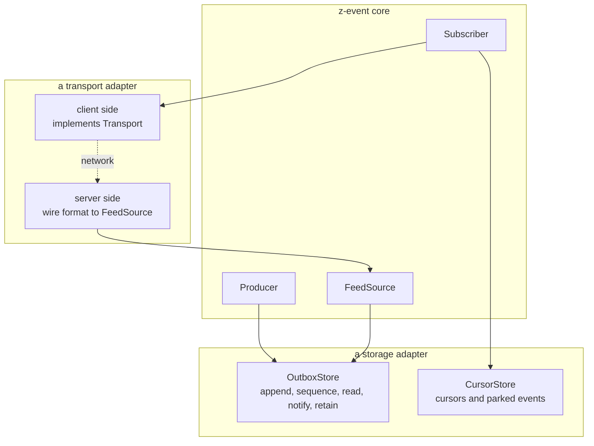
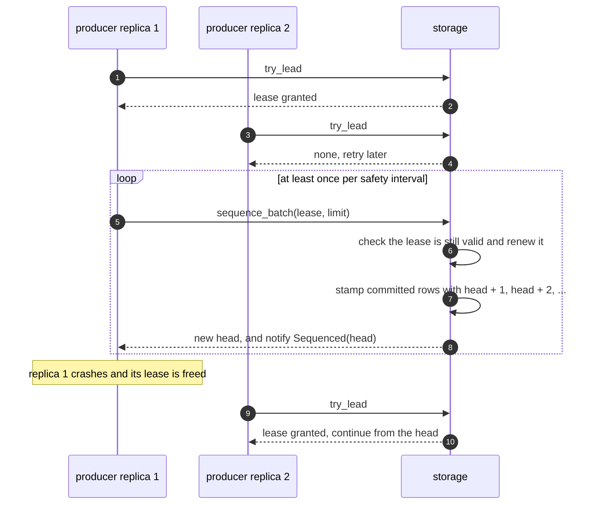
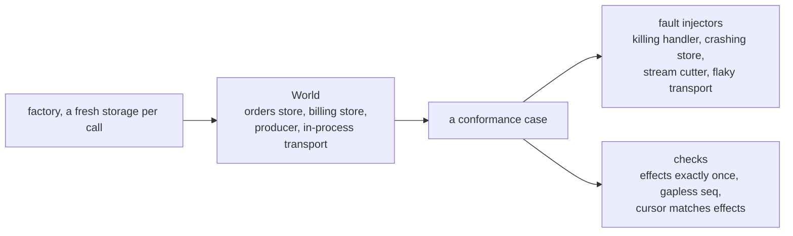
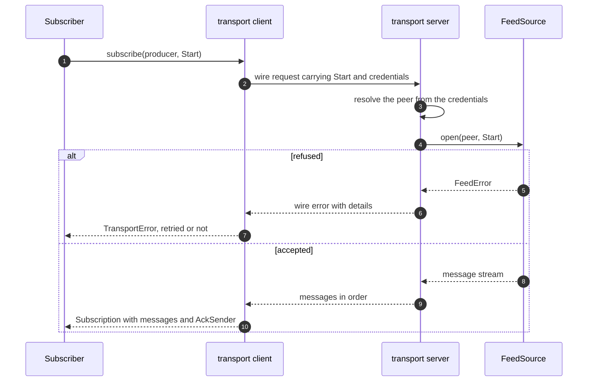

# Writing a z-event adapter

The z-event core knows nothing about databases or networks. Storage and transport are adapters that implement the core's traits, and this guide explains what each trait promises and how to prove that an adapter keeps those promises.

Three adapters in the repository serve as references. `z-event-memory` is the smallest and easiest to read, `z-event-postgres` is a production storage adapter, and `z-event-grpc` is a production transport. The architecture is explained in [DESIGN.md](../DESIGN.md).



## 1. Storage adapters

A storage adapter implements `Store`, `OutboxStore` for the producer side and `CursorStore` for the consumer side. Every async method is declared as `fn ... -> impl Future<Output = ...> + Send`, and the implementation simply writes `async fn`.

### The transaction

`Store::Tx` is the database's own transaction type, and the host application writes its business data through it as well. That shared transaction is the whole point of the design, because it makes the business change and its event, and the consumer's effect and its cursor, commit or roll back together. Dropping a transaction without committing must roll it back.

`begin_snapshot` returns a read-only transaction that sees one consistent state across all of its reads, and the core uses it for snapshots. The default implementation calls `begin`. An adapter whose default isolation level is weaker overrides it, as the PostgreSQL adapter does with `REPEATABLE READ READ ONLY`.

### The sequencing contract

The outbox must guarantee four things, and the conformance suite tests them hard.

1. A position is assigned only to committed events.
2. Positions increase strictly and without gaps within one epoch.
3. Once an event has a position it never changes, and nothing is later inserted below the head.
4. Two events for the same aggregate receive positions in their commit order.

The usual trap is that ids assigned at insert time are not in commit order, so reading everything after the last id seen can skip an event that committed late. z-event avoids it with a single sequencer. Writers insert events without a position, and one leader stamps committed events with the next positions.



The adapter decides how leadership and stamping work. A lease returned by `try_lead` must be exclusive. `sequence_batch` must fail when the lease is no longer valid, which is called fencing, and must renew it, and the producer calls it at least once per safety interval. Dropping a lease without calling `release` is treated as a crash, so the lease must free itself, by connection loss or by expiry. The PostgreSQL adapter holds a session advisory lock on a connection that belongs to the lease and runs the stamping statement on that same connection, so a lost connection means a lost lock.

Stamping must be one atomic step that takes committed, unsequenced events in a stable order, gives them the next positions and moves the head with them.

### The other promises

| Method | Promise |
|---|---|
| `read(after, types, limit)` | Sequenced events with a position after `after`, ascending, matching `types`, at most `limit` |
| `head` | The current head position, the epoch and `purged_through` |
| `notifications` | `Appended` after a commit that appended events and `Sequenced(head)` after stamping. These are hints that may be coalesced or lost, and on overflow the stream yields `Lagged` instead of dropping silently. Listening starts when the method is called, not when the stream is first polled |
| `register_consumer` and `ack` | `ack` only ever raises a consumer's position and ignores unregistered consumers |
| `purge(before)` | Delete the longest prefix that was sequenced before `before`, is acknowledged by every registered consumer and is below the head. Never delete the head event, and record the boundary as `purged_through` |
| `lock_cursor` | Exclusive per consumer and producer until the transaction ends. A second locker waits and then sees the committed value, like `SELECT ... FOR UPDATE`. The cursor is created on first use |
| `is_parked` | Sees the transaction's own `park` and `resolve` calls |
| `parked` | Ascending position, honouring the filter |

### Lessons from the PostgreSQL adapter

Use runtime-checked queries only. Compile-time checked query macros inside a library would check against the host's database at build time and break host builds.

Watch for futures that the compiler cannot prove `Send`. Some database libraries produce them in generic code, with an error like "implementation of `Executor` is not general enough". Keep temporaries such as `&format!(...)` out of `.await` expressions, bind values rather than references, and give public async helpers an explicit `-> impl Future<Output = ...> + Send` return type, so the check happens where the types are concrete.

Remember that a commit can land after its task is gone. With a networked database, a task that is killed after sending `COMMIT` can still have its transaction committed on the server. That does not break atomicity, but a test must not compare two separate reads of state that one transaction changes. The testkit's crash test reads the cursor under `lock_cursor` for exactly this reason.

### Proving a storage adapter

Add `z-event-testkit` as a development dependency and generate one test per conformance case.

```rust
// tests/conformance.rs
z_event_testkit::storage_suite!(|| async { MyStore::fresh().await });
z_event_testkit::transport_suite!(|| async { MyStore::fresh().await }, z_event_testkit::InProcessHarness);
```

When the database should live for the whole run, for example a container, run all cases in one test instead.

```rust
#[tokio::test(flavor = "multi_thread", worker_threads = 4)]
async fn conformance() {
    let db = start_database().await;
    z_event_testkit::storage::run_all(db.factory()).await;
}
```

The factory must return a new, empty storage on every call, which for SQL means a new schema. The store must implement both `OutboxStore` and `CursorStore`, because the test handlers record their effects by appending to the consumer store's own outbox in the handler's transaction. That keeps every effect atomic with the cursor and lets the suite count effects through the traits alone.



The storage suite has 28 cases. They cover the sequencing contract with 50 concurrent transactions committing in random order while some stay open and some roll back, a thousand crashes at random points inside handlers and right before or after store operations, sequencer failover, batching, parking and replay, retention, epochs and snapshot bootstrap.

Every run prints its random seed, and setting `ZEVENT_TESTKIT_SEED` to it repeats the run exactly. `ZEVENT_TESTKIT_SCALE=10` multiplies the iteration counts, for example to 10,000 crashes.

## 2. Transport adapters

A transport carries the protocol messages `Start`, `Ack`, `Event` and `Checkpoint` between processes. It has a server side and a client side.

The server side maps the wire format to the core's `FeedSource`. A new subscription calls `open(peer, start)`, then the adapter forwards the returned stream's messages in order and passes acknowledgements to `on_ack`. The adapter establishes `peer` from the connection, for example from a certificate or a token, and the feed checks that the consumer name matches it. `snapshot` and `head` complete the server side.

The client side implements `Transport`. `subscribe` returns the message stream and an `AckSender`. All failures map to one `TransportError`, so the subscriber can tell what to retry. `Closed`, `Unavailable`, `UnknownProducer` and `Protocol` are retried, and `PermissionDenied`, `EpochMismatch`, `BeyondRetention`, `Unsupported` and `InvalidRequest` stop the subscriber. The wire format must carry enough detail to rebuild these errors, and the gRPC adapter uses status codes plus metadata for that.



### Proving a transport adapter

Implement `TransportHarness`. It serves a `FeedSource` and returns a client that authenticates as a given peer, plus a guard that stops serving when it is dropped.

```rust
struct MyHarness;

impl TransportHarness for MyHarness {
    type Client = MyClient;

    async fn serve<S: OutboxStore>(&self, producer: &str, source: FeedSource<S>, peer: PeerId) -> (MyClient, Box<dyn Any + Send>) {
        let server = MyServer::start(producer, source).await;
        let client = MyClient::connect(server.address(), peer).await;
        (client, Box::new(server))
    }
}

z_event_testkit::transport_suite!(|| async { z_event_memory::MemoryStore::new() }, MyHarness);
```

The transport suite has 10 cases. They check delivery through repeated stream cuts, identity and access control, backpressure from a slow consumer, heartbeats, reconnect backoff, acknowledgements, ordering, `head`, snapshots and bootstrap through the transport.

A network transport should also be tested against real connection loss. The gRPC adapter sends 300 events through a TCP proxy that kills every connection after 50 to 300 milliseconds and checks that each event is applied exactly once.
